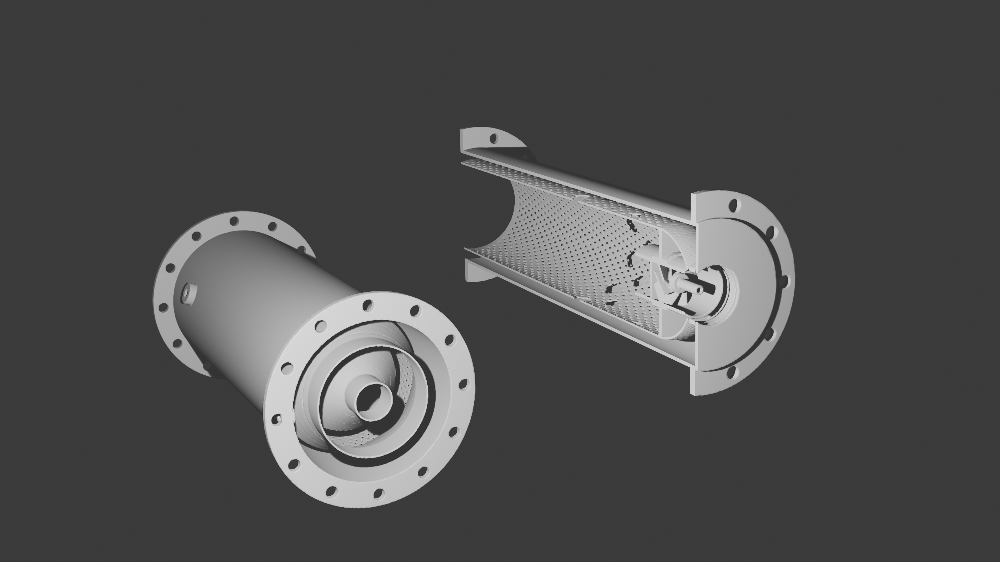

# QUASAR Phy-CB — Autonomous Design of 3D-Printable Brayton Combustors

<p align="center">
  
</p>

<p align="center">
  <a href="LICENSE"></a>
  = 3.10">
  
  
  
</p>

> **Spec (~6 numbers, or a sibling run) → physically verified combustor →
> printable LPBF parts.** The engineer writes the cycle conditions (P₃, T₃,
> ṁ, target T₄, fuel, max Δp/p) — or simply points at the
> `runs/<n>/geometry/*.json` of a Quasar compressor — and receives, on a
> laptop CPU and without proposing any geometry whatsoever: the air split,
> the hole sizing, the atomization, the 1-D liner thermal profile, the LBO
> margin, trend-level emissions, the self-contained HTML report, and the
> **printable STLs of the liner, casing, swirler and injectors with the
> additive-manufacturing constraints verified INSIDE the optimization
> loop** — self-supporting effusion holes, per-material wall thickness, and
> guaranteed powder drainability.
>
> Documents shipped in this repo:
> [docs/Quasar_PhyCB_Science.md](docs/Quasar_PhyCB_Science.md) (every
> equation with its verification status, the measured state of every layer
> and the declared limits) ·
> [docs/VALIDATION.md](docs/VALIDATION.md) (validation campaign and
> verdict).
> Cited throughout this README but **not shipped here**:
> `docs/Quasar_PhyCB_Plan.md` (executive proposal),
> `docs/PENDIENTES_Lverificar.md` (per-coefficient inventory of what is
> solid and what is not — its verdict is summarised in Science §13.2 and
> §19), `docs/IMPLEMENTATION_CONTRACT.md` (the frozen ABI — θ, the record
> and the constraint vector are described in Science §1.2–1.3) and
> `docs/Quasar_PhyCB_EstadoDelArte.md`. They are cited by name, without a
> link, so that a dead link never pretends to be a document.
> Phy-CB is the third sibling of **Phy-CC** (centrifugal
> compressors) and **Phy-AC** (axial compressors/fans) and shares their
> architecture: *calibrated physics prior → residual deep ensemble with
> uncertainty gate → constrained NSGA-II → self-contained report*.

**Read this first, before any number below:** this project practises
*calibrated honesty*. Every figure carries the fidelity it came from, the
things that do not work are written down in this README rather than hidden,
and the section [Declared Limitations](#declared-limitations) is not a
footnote — it is the part a reviewer should read before the feature list.

## Pipeline

```
spec (~6 numbers | Phy-CC/Phy-AC contract via --from-run)
   │   phycb_cli.py · neural_optimizer.design()            [Python, layers 1–4]
   ▼
verified design (θ 20-D + physical record, schema phycb-record-1)
   │   geometry_generator.py + dfam_checker.py             [layer 5a]
   ▼
geometry/combustor.json (schema phycb-combustor-1) · hole_table.csv ·
liner_profile.csv · effusion_field.csv · combustor_bom.csv ·
cfd_boundary_conditions.json · dfam_report.json  ─────────→ report.html [5b]
   │   PhyCBImport.FromContractJson(...) + PicoGK          [layer 5c, C#/.NET 9]
   ▼
Liner + Casing + Swirler + Injector/Vaporizer STLs (printable, DfAM-verified)
   + <Name>_field.vdb  (the SAME voxel field the CFD layer consumes)
   │
   └── cfd/   L1.5 cold LBM · L2a native IB-RANS               [first sibling
              (L2b OpenFOAM: OUT OF SCOPE — contract §12)       with internal CFD]
```

Layers 1–5b are Python (core: **NumPy only**). Layer 5c is the C# library
**CombustorDesigner** (.NET 9 + [PicoGK](https://picogk.org) NuGet), which
turns the optimized design into the real parts:

| Part | Exported file | Content |
|---|---|---|
| **Liner** | `<Name>_Liner.stl` | Revolved liner − hole rows − effusion field, dome, injector seats |
| **Casing** | `<Name>_Casing.stl` | Shell + bolted flanges + drain ports + igniter boss |
| **Swirler** | `<Name>_Swirler.stl` | Lofted vanes on the hub (unioned into the liner when the contract says `monolithic_with_dome`) |
| **Injector** ×N | `<Name>_Injector.stl` / `<Name>_Vaporizer{i}.stl` | By injector type (airblast · simplex · vaporizer · micromix) |
| **Assembly** (view) | `<Name>.stl` | Everything — **inspection only, do not print**; the parts interpenetrate at their seats on purpose |
| **Voxel field** | `<Name>_field.vdb`, `<Name>_Liner_field.vdb` | OpenVDB narrow-band SDF, mm. The kernel's native representation, so `cfd/` samples the *identical* field the STL was meshed from |

## Installation

Python **≥ 3.10** and, only for layer 5c (the printable parts), the **.NET 9
SDK**. The Python core is **NumPy-only**: every other dependency is optional
and, when it is missing, the stack degrades with a label in
`record["source"]` instead of failing.

```bash
# 0. Work from the repository root. ALWAYS - see the environment trap below.
cd "<path>/Phy-CB"

# 1. The minimum that runs layers 0-5b end to end
python -m pip install -U pip
pip install numpy

# 2. Optional, each one unlocking one capability (all degrade with a label)
conda install -c conda-forge cantera   # real equilibrium + the L1 CRN  <-- see the rule below
pip install matplotlib                 # report figures
pip install cadquery                   # STEP export
pip install cupy-cuda12x               # GPU backend actually used by cfd/ (CUDA 12.x)
pip install "jax[cuda]" xlb            # the L1.5 XLB backend (NumPy/CuPy fallback works without it)
pip install warp-lang                  # declared L2a backend - NOT used today (the solver runs on CuPy)
pip install pytest build               # to run the suites under pytest

# 3. Layer 5c (C#, printable STLs). PicoGK resolves as a NuGet package.
dotnet build CombustorDesigner.sln -c Debug
```

> **Cantera on Windows: conda-forge, NEVER pip.** The PyPI wheel links a
> single-threaded LAPACK and reactor networks run 4–8× slower (Cantera's own
> note). House rule, encoded in `pyproject.toml` and in CI.

> **Do not `pip install -e .` on a machine that also has a sibling project
> installed.** Phy-CB, Phy-AC and Phy-CC all publish top-level modules with
> the same names (`physics_core`, `neural_optimizer`, …), so an editable
> install makes `import physics_core` resolve to whichever `.pth` wins — no
> error, no warning, a plausible and completely wrong answer. The dependency
> groups are declared in `pyproject.toml` (`chem`, `plots`, `cad`, `cfd`,
> `cfd_native`, `dev`) for CI and for packaging; for day-to-day work install
> the dependencies as above and run from this root. See
> [The three integration findings](#the-three-integration-findings).

**Check the installation** (each command prints its own verdict):

```bash
python phycb_cli.py --info           # environment, fidelity ladder, provisional data
python data_pipeline.py --validate   # layer 0: 31/31 checks + SHA-256 manifest
python test_phycb.py                 # verification suite: 355/355, 1 declared skip (~35 s)
python validation/validate.py        # validation campaign -> validation/RESULTS.md
```

> **Optional dependencies present on the reference machine, measured
> 2026-09-10**: NumPy 2.4.6 · Cantera 3.2.0 · matplotlib 3.11 · CuPy 14.1.1
> (RTX 3070 Ti) · CadQuery 2.8.0 · JAX 0.11.0 · Pyrometheus · .NET SDK 10.
> **XLB and Warp are absent**, so L1.5 runs on its CuPy/NumPy fallback and
> L2a on CuPy. Text below that was written earlier may still say "no JAX":
> JAX was installed after those measurements and none of them depends on it.

## Quickstart

Everything below was **run on this machine while writing this README**
(Windows 11, Python 3.13.7, NumPy 2.4.6, Cantera 3.2.0, matplotlib 3.11,
.NET SDK 10.0.100, **NVIDIA GeForce RTX 3070 Ti 8 GiB (cc 8.6) with CuPy
14.1.1 working**; no Warp, no JAX, no XLB). The outputs are pasted verbatim,
trimmed only for length.

> **Correction, 2026-07-31.** An earlier revision of this README stated
> "no GPU" and concluded that L2a's performance target was unreachable
> here. **The premise was false** — the machine has an RTX 3070 Ti and CuPy
> was already installed. The CPU measurements were right and are kept; the
> conclusions drawn from them were not, and are redone below from GPU
> measurements. The error came from checking for Warp and JAX (the two
> backends named in `Ciencia §11.2`) and inferring "no GPU" from their
> absence, without checking the hardware or looking for alternatives.

> ⚠️ **Environment trap — run from the Phy-CB root, always.** On a machine
> that also has Phy-AC installed as an *editable* package, `import
> physics_core` from any other working directory silently resolves to
> Phy-AC's (axial-compressor physics, NDIM = 15). No error, no warning, a
> plausible and completely wrong answer. See
> [The three integration findings](#the-three-integration-findings).

```bash
cd "C:/Users/nickv/projects/Proyectos/Phy-CB"
python phycb_cli.py --help          # full flag reference
python phycb_cli.py --info          # environment, ladder, provisional data
python phycb_cli.py                 # no job given -> configuration wizard
```

### 1. One nominal design (no optimizer) — 17 ms of physics

```bash
python phycb_cli.py --p3 250000 --t3 430 --mdot 0.13 --t4 1150 \
    --outdir runs/smoke
```

```
--- [2/4] Dimensionado nominal (capa 1, WAVE1 §3) ──────────────────────────────
  ✓ record `phycb-record-1` en 17 ms · source='correlations_L0'
  reparto de aire nominal: pz=0.300  sz=0.120  dz=0.420  cool=0.160
  driver de dimensionado: aero · A_ref=33.35 cm² · D_ref=65.2 mm

--- [3/4] Geometría, estructural y DfAM (capas 1s y 5a) ────────────────────────
  ✓ estructural · Inconel-625 · g_struct OK
  ✓ geometría   → runs/smoke\geometry\ (7 archivos, 4 filas de orificios)
  ✓ DfAM        · orientación 'z+' · voxel 0.5 mm · IMPRIMIBLE

+----------------------------------------------------------------------+
| (o) Diseño nominal                                                   |
+----------------------------------------------------------------------+
| η_comb          0.9846                                               |
| Δp/p            0.0300   (máx 0.040)                                 |
| Pattern factor  0.350   (máx 0.40)                                   |
| T pared máx     1059 K                                               |
| EI_NOx / EI_CO  2.00 / 57.57 g/kg                                    |
| φ_PZ · τ        1.048 · 6.05 ms                                      |
| Envolvente      Ø 81.5 × 166.3 mm                                    |
| T₀₄ / P₀₄       1150.0 K / 242,500 Pa                                |
| Fidelidad       correlations_L0                                      |
| Estado           FACTIBLE                                            |
| Estructura       MÁRGENES OK   Inconel-625                           |
| DfAM             IMPRIMIBLE   voxel 0.5 mm · z+                      |
+----------------------------------------------------------------------+
```

**This verdict changed on 2026-07-31, and the reason matters more than the
result.** Until then the anchor came out **INFEASIBLE** with
`g[8] d_eff = +0.2147`: the effusion blowing ratio was M = 1.21, outside
the validity range of the film map, so the film effectiveness would be
*clamped* — i.e. invented — and the tool refused to call that feasible.

That M was wrong because of a **geometry** error, not a physics one: the
hot wall's wetted area was computed as `π·D_L·L_tot`, and `π·D_L` is the
perimeter of an **equal-area circle**. In annular architectures — the
anchor is one — the real outer perimeter is `2π·r_lo`, larger by
`r_lo/√(r_lo²−r_li²)` = **1.375**. With the correct area there are 3020
holes instead of 2197, M drops to **0.884** (inside the map) and
`g[8] = −0.1163`. The SOFT warning `g_soft['M_design']` = +0.10 stays on:
0.884 is outside the 0.3–0.8 *design* band, and that is said out loud.

The lesson survives, because it is the one the tool teaches: **fixing a
violated g is a design change, not a knob.** Drilling denser still lowers
M, and still collides with the DfAM printable-effusion band:

```bash
python phycb_cli.py --fix pitch_over_d_eff=4.5 --outdir runs/fix
```

```
  ⚠ 1 restricción(es) violada(s) de 26 — por esto NO es factible:
    g[25] dfam_effusion_band = +0.1000
```

This tension between *cooling physics* and *manufacturability* is exactly
what Phy-CB exists to expose inside the loop, and it is documented end to
end in `docs/PENDIENTES_Lverificar.md` §4
(§4.4 for the correction and the anchor move).

### 2. With the L1 chemical-reactor network (Cantera)

```bash
python phycb_cli.py --fidelity L1 --outdir runs/l1
```

```
  ✓ Cantera        · real equilibrium and L1 CRN available
  ✓ Fidelity       · L1 was asked for and L1 is what will really run
  ✓ record `phycb-record-1` en 2495 ms · source='crn_L1'
```

The `source` field always says which path actually ran. Without Cantera
the same command returns `crn_L1(cantera_unavailable→L0)` — it degrades
with a label, it never raises.

### 3. Autonomous optimization and the sibling seam

```bash
# Autonomous run (NSGA-II + deep ensemble with uncertainty gate):
python phycb_cli.py --optimize --quick --outdir runs/opt        # smoke budget
python phycb_cli.py --optimize --rounds 5 --n-init 320 --outdir runs/full

# Take the design point straight from a Phy-AC / Phy-CC run directory
# (P3/T3/mdot come from the compressor contract; T4 stays yours):
python phycb_cli.py --from-run <path/to/Phy-AC/runs/pr4> --t4 1250

# Engineer in the loop:
python phycb_cli.py --fix swirl_SN=0.8 --fix t_liner_mm=1.0 --seed 42
python phycb_cli.py --eval-theta "2,0.70,0.30,0.12,0.42,0.70,8,10,0.6,6,2,4,0.75,1.8,0.8,0"
python phycb_cli.py --outdir runs/full --list-pareto
python phycb_cli.py --outdir runs/full --pareto-pick 3 --stl
python phycb_cli.py --outdir runs/full --resume --rounds 3
python phycb_cli.py --sweep phi_pz --outdir runs/sweep   # the combustor "map"
```

Objectives (minimized): **−η_comb** and **EI_NOx**. Δp/p is *not* an
objective — in a combustor Δp is **spent** on mixing up to the cycle
allowance, so it enters as a hard constraint (`--dp-max`). The full
constraint vector is 26 components: 12 aero/thermal ⊕ 4 spec ⊕ 5
structural ⊕ 5 DfAM.

Measured on the `--quick` budget (132 physical evaluations, 14.5 s), and
worth pasting because the tool reports its own shortfall:

```
  ⚠ quality gate FAILED → extra round of space-filling sampling before optimizing.
⚠ el gate de calidad del surrogate NO se superó en ninguna de las 2 rondas: el
  presupuesto se gastó en muestreo espacial y NSGA-II nunca llegó a correr.
  el incumbente es el mejor punto MUESTREADO, no un óptimo del frente.

| Pattern factor  0.244   (máx 0.40)     | T pared máx  912 K                   |
| EI_NOx / EI_CO  2.71 / 40.55 g/kg      | Envolvente   Ø 65.2 × 208.3 mm       |
| Estado           FACTIBLE              | DfAM          IMPRIMIBLE             |
```

The smoke budget finds a **feasible, printable** design — but by
space-filling search, not by NSGA-II: the ensemble's uncertainty gate never
opened at 132 samples, so the surrogate was never trusted and the reported
point is the best *sampled* one. The tool says so instead of presenting it
as an optimum, and the house prescription (WAVE4 §7) is to enrich
`physics_features` rather than lower the gate threshold.

**The full budget does open the gate.** Measured with
`--optimize --rounds 5 --n-init 320` (460 physical evaluations, 108.5 s of
optimization) — a genuine 3-point verified Pareto front:

```
    #  fact arquitectura         η_comb    Δp/p     PF  T_w [K]  EI_NOx  source
    0   OK  annular              0.9846  0.0300  0.365    940.5    2.42  correlations_L0
    1   OK  annular              0.9797  0.0300  0.313   1120.2    2.12  correlations_L0
    2   OK  can                  0.9761  0.0300  0.389   1035.5    2.09  correlations_L0
```

Three feasible, printable designs trading combustion efficiency against
NOx, with two different architectures chosen by the gate θ[0]. Note how
narrow the NOx axis is (2.42 → 2.09) — that is
[limitation 3](#3-the-headline-nox-correlation-has-the-wrong-sign-in-deidφ_pz)
showing up in the product.

Interface control: `--interactive`/`-i` (wizard), `--no-color` (also
respects `NO_COLOR`), `--quiet`/`-q`.

### 4. Printable STLs (layer 5c)

```bash
python phycb_cli.py --p3 250000 --t3 430 --mdot 0.13 --stl --voxel 0.4
```

```powershell
# or manually:
& "C:\Program Files\dotnet\dotnet.exe" build CombustorDesigner.sln -c Debug
& "C:\Program Files\dotnet\dotnet.exe" `
  "CombustorDesigner.Example\bin\Debug\net9.0-windows\CombustorDesigner.Example.dll" `
  runs\smoke\geometry\combustor.json output\smoke 0.4   # json, outDir, voxel mm
#   optional 4th argument: part filter, e.g. "Liner" or "Vaporizer2"
```

Measured on this machine:

```
$ dotnet build CombustorDesigner.sln -c Debug
  CombustorDesigner -> ...\CombustorDesigner.dll
  CombustorDesigner.Example -> ...\CombustorDesigner.Example.dll
Compilación correcta.
    0 Advertencia(s)
    0 Errores
Tiempo transcurrido 00:00:01.42
```

Built from the smoke run's contract at 0.8 mm (~15 s of PicoGK time), this
is what actually lands on disk — note that the swirler is **absent as a
separate file** because this architecture declares
`monolithic_with_dome`, so it is unioned into the liner:

```
PhyCB_reverse_annular_Liner.stl          38.0 MB
PhyCB_reverse_annular_Casing.stl         26.8 MB
PhyCB_reverse_annular_Vaporizer1..6.stl  0.49 MB each
PhyCB_reverse_annular.stl                67.3 MB   ← assembly, INSPECTION ONLY
PhyCB_reverse_annular_field.vdb           5.9 MB   ← the SDF the CFD layer reads
dfam_report.json                         12.7 kB   ← as-built DfAM verdict
```

Voxel guidance: 0.8 mm draft, 0.5 mm iteration, 0.3–0.4 mm final; cost
scales as ~1/voxel³. **Read `dfam_report.json` before printing** — the
as-built check is stricter than the in-loop one and this design fails it
(see [Declared Limitation 10](#10-the-in-loop-dfam-check-passes-a-design-the-as-built-check-rejects)).

## Architecture — layers (the family CEM pattern)

| Module | Layer | Role | Status |
|---|---|---|---|
| [`data_pipeline.py`](data_pipeline.py) | **0** | Layer-0 policy: **every ⚠️ coefficient lives in a versioned CSV, never hard-coded**. 17 tables + SHA-256 `data/manifest.json`, `REMOTE_FILES = {}` (deliberately offline). Each table declares `status: verified\|provisional` and its primary source | ✅ 31/31 checks · 10 verified / 7 provisional tables |
| [`physics_core.py`](physics_core.py) | **1** | Multi-fidelity core: `evaluate(theta, fidelity)` → `phycb-record-1`. L0 = full Lefebvre correlation set + Cantera equilibrium (sizing, air split, holes, atomization, 1-D liner thermal, LBO, pattern factor, 5-correlation NOx fan); `g(θ)` ×12 continuous; 37 physics features; affine hi-fi calibration hook | ✅ L0 · L1 dispatch · degradation labels |
| [`crn_core.py`](crn_core.py) | 1 | L1: 1-D flow network + Cantera chemical-reactor network (PSR + PFR), Damköhler-based LBO, per-solve timeout | ✅ `crn_L1` measured at 2.5 s |
| [`structures_core.py`](structures_core.py) | 1s | Materials library with thermal derating (9 alloys), liner/casing hoop and thermal stress, min wall, **hot-wall banned material rule** (`Inconel-718` above 923 K). 5 hard constraints | ✅ |
| [`dfam_checker.py`](dfam_checker.py) | 1d | **The differentiator**: LPBF manufacturability as a first-class constraint *inside* the loop — min thickness, min hole Ø, ≥45° overhang or self-supporting teardrop, **powder drainability** (≥2 line-of-sight exits per cavity), effusion pitch/porosity band. 5 hard constraints | ✅ |
| [`neural_optimizer.py`](neural_optimizer.py) | 2–4 | Deep ensemble with uncertainty + quality gate, NSGA-II with Deb's constrained dominance, LCB acquisition + k-means batching, orchestrator `design(spec)` — ported from Phy-AC (domain-agnostic core) | ✅ |
| [`geometry_generator.py`](geometry_generator.py) | 5a | `phycb-combustor-1` contract + `hole_table.csv`, `liner_profile.csv`, `effusion_field.csv`, `combustor_bom.csv`, CFD boundary conditions, optional STEP | ✅ 7 artefacts/run |
| [`report_generator.py`](report_generator.py) | 5b | Self-contained HTML report, 13 sections (pure-Python SVG) + a prominent **LÍMITES DECLARADOS** block listing the active provisional warnings of *that* record | ✅ |
| [`visualization.py`](visualization.py) | 5b | Optional matplotlib figures with silent degradation: `air_split`, `liner_thermal`, `liner_profile`, `emissions_fan`, `pareto` — plus the CFD set (`generate_cfd`): meridional velocity-magnitude cut, u_z < 0 recirculation, streamlines, convergence + cells-per-feature, and the air split *correlation vs 1-D network vs measured*. The CLI emits them when a run reaches L1.5 | ✅ |
| [`cycle_seam.py`](cycle_seam.py) | 4 | `hot_cycle(record, TIT_K, ..., combustor=None)` and `cycle_adapter(record)` — the Brayton hot-cycle seam, implemented **on Phy-CB's side** (see finding §0) | ✅ |
| [`cfd/xlb_cold.py`](cfd/xlb_cold.py) · [`cold_post.py`](cfd/cold_post.py) · [`crn_from_field.py`](cfd/crn_from_field.py) | L1.5 | Cold isothermal lattice-Boltzmann over the voxels → real air splits, jet penetration, recirculation topology → auto-topology for the CRN. Two backends behind one API: XLB (absent here) and a **pure-NumPy D3Q19 BGK fallback** with Smagorinsky LES | ⚠️ runs, **not quantitative at reachable resolution** — see below |
| [`cfd/ibrans/`](cfd/ibrans/) | L2a | Native immersed-boundary RANS on the SDF: `mesh` · `solver` · `turbulence` · `chem` · `post` · `backend` | ⚠️ **M1 done and verified · M2–M4 skeleton** — [`cfd/ibrans/ESTADO.md`](cfd/ibrans/ESTADO.md) |
| [`CombustorDesigner/`](CombustorDesigner/) + [`.Example/`](CombustorDesigner.Example/) | 5c | C# + PicoGK: contract → liner, casing, swirler, injectors as printable STLs; re-verifies DfAM on the built voxels; exports the `.vdb` field | ✅ builds clean (0 warnings, 0 errors) |
| [`phycb_cli.py`](phycb_cli.py) | product | End-to-end CLI: spec → design → geometry → DfAM → report → dataset [→ STLs] | ✅ |
| [`test_phycb.py`](test_phycb.py) | VV&UQ | Verification suite T1–T40 + T49, dual mode (table or pytest) | ✅ **359/359, 0 skipped** with `--slow` |
| [`validation/`](validation/) | VV&UQ | Validation campaign A–F → [`validation/RESULTS.md`](validation/RESULTS.md) | ✅ runs · **107 PASS / 49 declared gaps** |

Line counts (measured): `physics_core.py` 3 742 · `test_phycb.py` 2 329 ·
`report_generator.py` 2 175 · `data_pipeline.py` 2 087 ·
`geometry_generator.py` 1 985 · `crn_core.py` 1 822 · `dfam_checker.py`
1 575 · `phycb_cli.py` 1 543 · `structures_core.py` 1 089 ·
`neural_optimizer.py` 928 · `visualization.py` 613 · `cycle_seam.py` 540 ·
`cli_style.py` 330 — plus `cfd/` (7 974 lines across 16 modules: 3 163 for
L1.5, 3 237 for the L2a solver, 1 574 of CFD tests) and 12 C# files
(196 kB).

## The fidelity ladder

The contract (`Fidelity` IntEnum) is frozen: `L0=0 · L1=1 · L15=2 · L2A=3 ·
L2B=4`. Science §10 defines what each level *predicts* and — as
importantly — what it **does not**. Below, the third and fourth columns are
the science; the last is the **measured** implementation state on this
machine.

| Level | Cost | Predicts reliably | Does **NOT** predict | Implementation state |
|---|---|---|---|---|
| **L0** correlations + Cantera equilibrium | ~17 ms (measured) | T_ad, T₄, FAR, sizing, nominal splits, Δp/p, trends of η/PF/LBO/EI | anything spatial | ✅ **complete**. `source="correlations_L0"`, or `correlations_L0(cantera_unavailable)` on the pure-NumPy path |
| **L1** 1-D network + CRN (Cantera) | 2.5 s (measured) | real 1-D splits, per-zone τ, NOx/CO trends (±30–50 %), LBO via Damköhler, η_comb | PF, local wall temperature | ✅ **complete**. `crn_L1`, degrading to `crn_L1(cantera_unavailable→L0)`, `crn_L1(timeout→L0)`, `crn_L1(diverged→L0)` |
| **L1.5** cold LBM over the voxels | minutes (NumPy fallback) | 3-D air splits, jet penetration, recirculation topology → CRN auto-topology | anything thermal (zone density corrected from L0) | ⚠️ **implemented and runs, but NOT quantitative at the resolution reachable on CPU** — see [Declared Limitations](#4-l15-is-topological-not-quantitative) |
| **L2a** native IB-RANS on the SDF | 5–30 min *on a GPU* | flow topology, dilution penetration, **PF ranking and hot spots between designs**, Δp/p ±15–20 %, T₄ ±3–5 % | absolute NOx (×2–10), absolute PF, quantitative LBO, thermoacoustics, **quantitative metal temperature** | ⚠️ **M1–M3 DONE and V&V-verified; M4 implemented but NOT closed.** `solve()` now returns the §4.4 product (or `None` with a labelled `DEGRADE_TAG`), yet the anchor case still misses T₄ ±5 % and cannot be contrasted on Δp/p — see `cfd/ibrans/ESTADO.md` §12 |
| **L2b** OpenFOAM `reactingFoam` | 0.5–12 h | L2a + CHT + radiation ⇒ the *quantitative metal temperature* | absolute NOx | ❌ **OUT OF SCOPE** (contract §12). The enum value is kept — it is ABI — and `--fidelity L2B` degrades with `source="openfoam_L2B(out_of_scope→…)"` |

### L2a milestone M1 — the V&V ladder passes, with no threshold loosened

Measured with `python -m pytest cfd/tests/test_ibrans_v1_v3.py -q` and the
two manual scripts for the expensive cases. Thresholds are the ones Science
§13.1 fixed *before* the runs:

| Case | Reference | Criterion | Measured |
|---|---|---|---|
| V1a Poiseuille, both walls immersed and offset 0.25 dx | analytical | < 2 % | **0.17 %** ✅ |
| V1b Couette, moving immersed wall | analytical | < 2 % | **0.04 %** ✅ |
| V2 lid-driven cavity, Re = 100 (32²) | Ghia et al. 1982 | max\|Δu\| < 0.05 | **0.0044 / 0.0070** ✅ |
| V2 lid-driven cavity, Re = 1000 (128²) | Ghia et al. 1982 | max\|Δu\| < 0.05 | **0.0048 / 0.0099** ✅ |
| V3 cylinder in cross-flow, C_d (D/10) | 1.35 (Liu 1998) | ±10 % | **1.3958 → +3.4 %** ✅ |
| V3 cylinder in cross-flow, Strouhal (D/10) | 0.165 (Williamson 1989) | ±10 % | **0.16638 → +0.8 %** ✅ |

The two expensive cases are **not silent skips**: they were run, they pass,
and they live in `PHYCB_SLOW=1` plus `cfd/tests/run_v2_re1000.py` /
`run_v3_cylinder.py`. Re-run end to end while writing this README —
`python cfd/tests/test_ibrans_v1_v3.py --slow` — the whole ladder is green:

```
  [OK  ] V1a   Poiseuille laminar, paredes inmersas          13.0 s
  [OK  ] V1b   Couette, pared inmersa movil                  13.2 s
  [OK  ] V2a   Cavidad Ghia Re=100 (32^2)                    18.8 s
  [OK  ] V2b   Cavidad Ghia Re=1000 (128^2) [lento]         872.1 s
  [OK  ] V3a   Cilindro IB malla mini (St)                   16.0 s
  [OK  ] V3b   Cilindro IB D/10 (Cd y St) [lento]           539.3 s
  [OK  ] M0a   distancia a pared = |phi| exacta               0.0 s
  [OK  ] M0b   L2A degrada etiquetado (contrato §3)           2.8 s
  [OK  ] M0c   M2/M3 declaran su ausencia                     0.0 s
  TODO EN VERDE
```

The full story — including the two real bugs the
ladder caught (a sealed fluid volume that made the residual *identically
zero*, i.e. a solver "converging" without moving anything, and a Newton
iteration for Spalding's law replaced by bounded bisection) — is in
[`cfd/ibrans/ESTADO.md`](cfd/ibrans/ESTADO.md).

**M1's performance objective IS met — on the GPU.** WAVE6 targets 500 k
cells × 10 k iterations in 5–40 min. `Ciencia §11.2` names Warp and JAX as
the backends; neither is installed. But **CuPy is**, it is a near drop-in
NumPy replacement, and it needs nothing installed. Measured with the real
solver via `python cfd/tests/run_perf_budget.py`:

| Case | Cells | NumPy/CPU s/cell/step | CuPy/GPU s/cell/step | GPU speed-up |
|---|---|---|---|---|
| public GPU FP32 reference (JAX-Fluids) | — | — | 1e-8 | — |
| 3D n=32, RK3 | 32 768 | 4.94e-7 | 1.34e-6 | **×0.4 (CPU wins)** |
| 3D n=40, RK3 | 64 000 | 4.87e-7 | 6.60e-7 | ×0.7 |
| 3D n=60, RK3 | 216 000 | 1.83e-6 | 1.99e-7 | ×9.2 |
| **3D n=80, RK3** | **512 000** | **1.84e-6** | **8.65e-8** | **×21.2** |
| 3D n=128, RK3 | 2 097 152 | 1.84e-6 | 5.02e-8 | ×36.7 |

**Verdict on the wave's target case: NumPy 2.55 h (missed) · CuPy 4.2 min
(met).** The GPU sits ×5–8 off the public FP32 reference, not ×270.

Two measured caveats worth keeping:

* **Below ~100 k cells the CPU wins** (crossover measured between 64 k and
  141 k): at 32 k cells the GPU is ×0.4, i.e. *slower*, because kernel
  launch latency dominates. `backend="auto"` stays on NumPy under
  `GPU_MIN_CELLS = 100_000` for exactly this reason.
* **The numbers move when the GPU is shared.** The same 512 k case measured
  1.17e-7 s/cell/step with the card free and 2.01e-7 with another job
  holding it at 99 %. Both are reported in
  [`cfd/ibrans/ESTADO.md`](cfd/ibrans/ESTADO.md) §5.

What this does **not** change: M2/M3/M4 are still skeletons and `solve()`
still returns `None` on purpose. Having a fast backend removes the
*compute* blocker for M2/M3, not the modelling work.

## Wave status

| Wave | Deliverable | Status | Evidence |
|---|---|---|---|
| **W0** Setup and conventions | `evaluate()` contract, θ, verbatim copies of `neural_optimizer`/`cli_style`, T1–T5 | ✅ **done** | T1–T5 green, including the provenance sentinel (T1) |
| **W1** L0 core | Lefebvre + Cantera + 1-D thermal + emissions + report + layer 0 | ✅ **complete · ❗ NOT CLOSED** | 17 layer-0 tables with SHA-256; but 17 of 19 ⚠️ coefficients remain provisional and none has been checked against the canonical source. Verdict and checklist: `docs/PENDIENTES_Lverificar.md` §7 |
| **W2** L1 CRN + structural | 1-D network, Cantera CRN, `structures_core` | ✅ **done** | T17–T24; `source='crn_L1'` measured at 2 495 ms |
| **W3** Geometry + DfAM | `phycb-combustor-1`, C#/PicoGK, DfAM checker | ✅ **done** (with a real finding) | T25–T31 (T29 = real C#/PicoGK smoke, runs under `--slow`); solution builds with 0 warnings; STLs + `.vdb` generated and inspected. The **as-built** voxel DfAM check rejects the anchor casing on overhang at both 0.8 and 0.4 mm — [limitation 10](#10-the-in-loop-dfam-check-passes-a-design-the-as-built-check-rejects) |
| **W4** Optimizer + integration | `design(spec)`, `--from-run`, `combustor=` in `hot_cycle` | ✅ **done** | T32–T40, incl. the end-to-end T40 (7/7) and the 26-component global g; a full-budget run (460 evals) produces a real 3-point verified Pareto front |
| **W5-A** L1.5 XLB → auto-CRN | Cold LBM, cold post-processing, CRN auto-topology | ⚠️ **implemented and running, FAILING its own acceptance** | `test_cfd_l15.py --slow`: T41 ✓ · T42 ✓ · **T43 ✗** (J=4 at +30.4 % vs ±25 %) · **T44 ✗** (anchor splits far off, Δp/p ×123, not converged) · **T45 ✗** (shares T44's field). Diagnosis and numbers: [limitation 4](#4-l15-is-topological-not-quantitative) |
| **W5-B** L2b OpenFOAM | — | ❌ **out of scope** (contract §12) | T46–T48 are declared SKIPs, never false greens |
| **W6** L2a native CFD | IB-RANS in 4 milestones | ⚠️ **M1–M3 done and verified · M4 implemented, not closed** | V1–V7 pass; M4 runs end to end and the flame **anchors in the real combustor** (risk #1 resolved), but T₄ is +25.7 % off the balance and Δp/p is not comparable to the 1D network until the liner–casing annulus is resolved (dx ≤ 1 mm). Numbers and diagnosis: `cfd/ibrans/ESTADO.md` §12 |
| **W7** V&V and validation | Campaign, anchors, CI, VALIDATION.md | ✅ **run, reproducible, and it found things** | 107 PASS / 49 documented gaps (G1–G15); `REF_CB10` anchor reproduced bit-for-bit |

**Verification vs validation** — the family keeps these strictly apart:

| | Question | Where | Measured today |
|---|---|---|---|
| **Verification** | do we solve the equations *right*? | `test_phycb.py` (T1–T40, T49) + the CFD V1–V9 ladder | `python test_phycb.py` → **355/355 OK, 1 declared skip, 34 s**; `--slow` → **359/359 OK, 0 skipped, 38 s** |
| **Validation** | are they the *right* equations? | `validation/` → [`docs/VALIDATION.md`](docs/VALIDATION.md) | `validate.py` → **PASS 107 · FAIL 48 (48/48 known, documented gaps) · N/E 1** (measured 2026-09-10) |

The campaign's own short answer, quoted from `docs/VALIDATION.md` §1:
Phy-CB gets the **air split → φ_PZ** chain right against the one real
machine with two published points (**+1.55 % and +0.20 %**, no
per-machine recalibration). Everything else is unanchored: five constants
govern the headline numbers and three of them are calibrated to a *single*
point.

## Declared Limitations

This section is deliberately long, deliberately near the top, and
deliberately not softened.

### 1. No quantitative metal temperature, at any fidelity level

L2b (OpenFOAM, CHT + radiation, documented ≤10 % error) was the level that
was going to produce it. It is **out of scope** because the target machine
is Windows and OpenFOAM would require WSL2 or Docker (contract §12). That
capability **disappeared from the system; it did not move elsewhere**:

> Phy-CB does not predict quantitative metal temperature at any fidelity
> level. The L0 1-D liner thermal model gives the *trend* and the *margin*
> against the material limit; L2a will give **adiabatic** wall maps for
> *ranking* between designs. Closing this gap requires a test rig
> (validation level F) or reactivating L2b on a machine with WSL2/Docker.

How much this matters is measured, not asserted: in validation case D1
(Bath/HiETA, T₃ = 1093 K) the model declares that **Inconel 625 does not
survive** (T_w1 = 1466 K vs a 1253 K limit) — and Bath/HiETA built and
ran that combustor in Inconel 625. That is gap **G12**, the cleanest
falsification of the campaign, and it is robust across 18 combinations of
air split and hole count.

### 2. Absolute NOx is never promised

Not at L0, not at L1, not at L2a. Emissions are delivered as **trend and
order of magnitude (×2)**, and every L2 figure carries the label
*"design comparison / hot-spot detection — not suitable for emissions
certification"*.

### 3. The headline NOx correlation has the WRONG SIGN in dEI/dφ_PZ

This one deserves its own heading because **EI_NOx is an optimizer
objective**.

`record["EI_NOx"]` is currently `EI_NOx_lefebvre`. Lefebvre's form uses the
**fixed stoichiometric temperature** T_st inside the exponential and the
**primary-zone temperature** in the denominator, so it does not actually
depend on φ_PZ; the −25 % slope observed across a lean sweep is a pure
artefact of the denominator (grams of NOx *per kg of fuel*, and the fuel
flow moves with η_comb). Measured sweep:

| φ_PZ | **lefebvre (headline)** | zonal | odgers | laviolette |
|---|---|---|---|---|
| 0.604 | 2.619 | 0.013 | 0.527 | 0.023 |
| 0.797 | 2.221 | 1.048 | 3.251 | 0.544 |
| **1.048** | **2.000** | **3.756** | **8.911** | **3.172** |
| 1.260 | 2.102 | 0.246 | 5.594 | 1.405 |
| 1.599 | 2.376 | 0.000 | 1.597 | 0.157 |

The three **zonal** forms give the correct sign *and* peak at φ_PZ ≈ 1.05,
right where T_ad peaks. The headline does not. Anyone can reproduce it in
one command — `python phycb_cli.py --sweep phi_pz` writes
`sweep_phi_pz.csv` with the geometry frozen:

| φ_PZ | 0.632 | 0.766 | 0.932 | **1.048** | 1.198 | 1.402 | 1.704 | 2.221 |
|---|---|---|---|---|---|---|---|---|
| **EI_NOx** (headline) | 2.550 | 2.273 | 2.056 | **2.000** | 2.058 | 2.210 | 2.469 | 2.764 |
| EI_CO | 263.8 | 135.4 | 70.0 | **57.6** | 70.6 | 113.6 | 220.9 | 400.2 |

The headline NOx has its **minimum exactly at φ_PZ ≈ 1.05** — the point
where the adiabatic flame temperature is highest and thermal NOx should be
at its *maximum*. (EI_CO, by contrast, bottoms out there correctly.) So as
an optimizer objective, `EI_NOx` carries the **wrong gradient** with
respect to φ_PZ.

What that does to a real 20-D run is a separate question, and it should be
measured rather than inferred. Measured, on the full budget (460
evaluations, 5 rounds): the verified Pareto front is 3 feasible points
spanning **EI_NOx 2.42 → 2.09 g/kg** while η_comb goes 0.9846 → 0.9761. A
±7 % spread in the NOx objective across the entire front is the practical
symptom of the same defect — **Lefebvre's form barely depends on the
design, so as an objective it hardly discriminates at all.** (The
recommended point sits at φ_PZ = 0.616 with EI_CO = 214 g/kg, ×3.7 the
nominal design's 57.6: the front is buying its small NOx gain with a large
CO penalty that no objective is watching.)

This is gap **G13**, it is priority #1 in the recalibration list,
and — unusually — it costs no new data: it is a model choice, one line in
`physics_core.py`. It is documented rather than silently patched because
changing the record's headline key moves the frozen `REF_CB10` anchor, and
the house rule is that moving an anchor is a deliberate act
(`--freeze-anchors`) that cites the correction that moved it.

Two companion findings: **G14** — the Rizk & Mongia *global* form is
insensitive to φ_PZ by construction (0.00 % over the whole sweep); **G15**
— the *zonal* form is insensitive to τ (< 2 %). For a φ trend use the
zonal; for a τ trend use Odgers or Lefebvre.

### 4. L1.5 is topological, not quantitative

The cold-LBM level resolves its backend as XLB → **CuPy (GPU)** → NumPy
and labels which one ran. XLB is not installed; CuPy is, so the anchor now
runs on the GPU at **193 MLUPS (5.17e-9 s/cell/step)**, which beats the
1e-8 reference of `Ciencia §11.2`.

**This bought resolution, and resolution was not the binding constraint.**
The anchor went from 0.92 M nodes at dx = 1.229 mm (annulus 2.0 cells) to
**6.98 M nodes at dx = 0.613 mm** (annulus 4.0 cells, min hole Ø 8.4
cells), and it *converged* — 37 800 steps, 1 365 s. The acceptance tests
still fail, and the diagnosis changed:

> **τ stays pinned at `TAU_FLOOR` = 0.5015 against a molecular
> 0.50001–0.50003, so the effective viscosity is ×53–106 the real one and
> Δp/p comes out 0.587 against a design 0.030.** Refining the mesh halved
> the viscosity ratio and did not fix it. What is needed is a collision
> operator that survives τ → 0.5 (MRT/TRT/regularised BGK), **not more
> cells.**

An earlier revision of this file predicted that "dx ≤ 0.6 mm would make it
quantitative". That prediction has now been **refuted by measurement** and
is recorded here rather than quietly dropped. The standing limit:

> **The L1.5 cold field is usable for TOPOLOGY — recirculation structure,
> which way the air goes, CRN auto-topology — and is NOT quantitative.**

That is not a prediction — it is what the acceptance tests measure.
`python cfd/tests/test_cfd_l15.py --slow` on this machine:

| Check | Criterion | Measured | |
|---|---|---|---|
| **T43** jet in cross-flow, J = 4 | Y/d within ±25 % of 1.15·√J | Y/d 3.00 vs 2.30 → **+30.4 %** | ✗ |
| T43, J = 16 | ±25 % | 5.20 vs 4.60 → +13.0 % | ✓ |
| T43, J = 36 | ±25 % | 6.70 vs 6.90 → −2.9 % | ✓ |
| T43 monotonicity | Y/d grows with J | 3.00 → 5.20 → 6.70 | ✓ |
| **T44** KJ66 anchor splits vs the L1 1-D network | per zone \|LBM − network\| < 20 % | pz −22.5 % · sz **−62.1 %** · dz **−51.4 %** · cool **+242.5 %** | ✗ |
| T44e LBM inlet/outlet mass closure | < 1 % | 1.013 % | ✗ |
| T44g LBM Δp/p vs the design value | < ×3 | **3.70 vs 0.030 → ×123** | ✗ |
| T44h statistically steady state | converged | **not converged in 9 400 steps** | ✗ |
| **T45** auto-topology CRN vs the manual one | same NOx trends | dragged by T44 — shares the same field | ✗ |

**Why, measured rather than argued.** The anchor mesh comes out
69 × 69 × 193 = **918 873 nodes at dx = 1.229 mm** (the node budget is
capped; finer means more nodes than NumPy can carry). At that spacing:

* τ is pinned at `TAU_FLOOR = 0.5015` while the molecular value would be
  0.5000138 — so the **effective viscosity is ×109 the real one**, and the
  computed Reynolds number is **≈ 6 627 against a physical 722 548**.
* The liner wall is **0.80 mm thick, thinner than one 1.229 mm cell.**
  27 188 gas cells (9.6 % of the liner volume) had to be **forced solid**
  to seal it — without that the liner leaks and the measured splits are
  garbage. That sealing is itself a declared distortion.
* The effusion holes (Ø 0.6 mm) are unresolvable and enter as distributed
  transpiration; their momentum is not modelled at all.

The weak jet (J = 4) is exactly the case a too-viscous field would keep
standing up too long, and it is the one that fails; the strong jets
(J = 16, 36), dominated by momentum rather than diffusion, pass. That
pattern is the signature of the resolution limit, not of a coding error —
and the similarity station used for T43 was derived **a priori** from the
classical trajectory (1.6·s₀^⅓ = 1.15 ⇒ s₀ = 0.371) and **was not moved to
make the test pass**.

One anchor field costs **2 378 s (~40 min) at 3.63 MLUPS** on this CPU. So
the honest summary of W5-A: the plumbing is complete and the auto-CRN path
works end to end, but **the numbers it produces do not meet the wave's own
acceptance criteria, and they are reported as failing rather than
re-tuned into compliance.**

### 5. Δp/p is imposed, not predicted (at L0)

`record["dp_over_p"]` reproduces the target **by construction**: the hole
areas are sized to meet it. In a microturbine Δp/p is a hard cycle
constraint, not an output. Validating it requires `dp_over_p_cfd` from
L1.5/L2a. The v1 criterion "Δp/p ±20 %" is therefore **not evaluable**
today, and `docs/VALIDATION.md` §3 says so.

### 6. The pattern factor returns its own calibration

PF = 0.35000 in all six validation cases, across three power classes and
both KJ66 points. `PF = exp[−k·(L_DZ/D_L)·(ΔP_L/q_ref)]` with `k` fitted to
**one** point, and with the aerodynamic sizing criterion `ΔP_L/q_ref = 15`
is an algebraic identity — so PF has no case-dependent degree of freedom
left. **PF is not validated** (gap G5).

### 7. LBO is not validated, and with airblast the numbers are not credible

φ_LBO ∝ D₃₂², and the airblast SMD comes out ×3–4 small versus the class
band, producing LBO margins of **×42 (A2) and ×476 (D1)**. A margin of ×476
says "this chamber never blows out" — that is a symptom, not a result (gap
G8). The vaporizer cases survive because their SMD is the verified KJ66
d₅₀ = 50 µm, not a correlation.

### 8. Open provisional coefficients — 43 warnings reach the anchor's numbers

Layer 0 has **17 tables**; 7 carry `@status: provisional` at table level
and **107 of 368 status-bearing rows** are provisional. In the `REF_CB10`
anchor **43 warnings** reach a reported number, and they travel inside the
record under `limitations` and are printed in every `report.html`.

**Zero coefficients have been closed against the canonical primary source**
(Lefebvre & Ballal, 3rd ed. — the book is not available on this machine).
Five of them move a headline number by more than 20 %, with the movement
**measured** by perturbing the layer-0 table and re-evaluating the anchor:

| Coefficient | What it moves | Measured movement |
|---|---|---|
| `EPS_G_FLOOR_LUMINOUS = 0.15` (house calibration) | `T_wall_max_K` | sweeping the literature band 0.05–0.60 → **808 K ↔ 1573 K**, and `g[1]` **changes sign** |
| `rad_internal_prefactor = 0.50` | T_w1 | ×2 → 1302.6 K (+23.0 %) |
| `k_dilution = 0.0388823` (fitted to one point) | PF | ×0.5 → 0.592 (+69 %); ×2 → 0.1225 (−65 %) |
| `C_LBO_SI` (fitted to one point, ±45 % declared) | φ_LBO, LBO margin | ±45 % → margin **0.378 ↔ 2.634** |
| η_c(θ) chart (one anchoring point, house-fitted shape) | the whole sizing | if the real chart needed θ ×2: A_ref **+58.8 %**, V_c and τ **×2**, D_casing +26 % |

Two of these are *self-referential in the anchor*: the k of PF and C_LBO
are calibrated to the anchor itself, so in the anchor they do not predict —
they return their calibration.

The full inventory, with per-coefficient impact and what exactly would
close it, is `docs/PENDIENTES_Lverificar.md`.
**WAVE1 is declared COMPLETE but NOT CLOSED** for precisely this reason.

### 9. The class reference table contradicts itself

The validation campaign found that `data/reference/class_table.csv` — the
number-one anchor of the validation plan — is **internally inconsistent**:
the enthalpy balance (pure algebra, no provisional coefficient inside)
applied to the table's own (T₃, T₄) bands imposes a FAR that does not
overlap the FAR band the table declares, and for class 0 (non-recuperated
by definition) it is outright impossible. That single data defect explains
**17 of the 49 FAILs**. The action is to **fix the data, not the model**:
calibrating against an inconsistent datum is the worst possible move in a
validation campaign (gap G1).

### 10. The in-loop DfAM check passes a design the as-built check rejects

There are **two** manufacturability checks, and they disagree on the anchor
design. `dfam_checker.check()` (Python, 5 analytic constraints, cheap
enough to sit inside the optimizer loop) calls the smoke design
**PRINTABLE**. `DfamVoxelCheck` (C#, 3 constraints measured on the
**built voxels** after PicoGK has actually made the part) calls it
**FAIL**. Measured, by building the same contract twice:

```
$ ...CombustorDesigner.Example.dll runs/smoke/geometry/combustor.json out 0.8
DfAM VIOLATION - overhang: part 'Casing' has 2.359 % of its solid cells with no
  support within 45 deg beneath them in build 'z+' (tolerance 0.5 %)
DfAM voxel verdict: FAIL  g = [+3.7179, -1.0000, -1.0000]
WARNING liner wall: thickness clamped 0.8 -> 1.6 mm (2 voxels at 0.8 mm).
  The PRINTED part is thicker than the verified design.

$ ...same contract, voxel 0.4
DfAM VIOLATION - overhang: part 'Casing' has 2.366 % ...
DfAM voxel verdict: FAIL  g = [+3.7311, -1.0000, -1.0000]
  (no thickness-clamp warnings at 0.4 mm)
```

Two distinct things, and the pair of runs separates them:

* **The casing overhang violation is REAL, not a discretization artefact.**
  Halving the voxel moves it from 2.359 % to 2.366 % — i.e. not at all.
  The casing genuinely has down-skin surfaces below 45° in the `z+` build.
  The analytic checker does not catch it because it reasons about the
  *contract*, not about the swept solid.
* **The thickness clamp IS a discretization artefact.** At 0.8 mm voxel the
  0.8 mm liner wall and the 1.2 mm swirler vanes are clamped up to 1.6 mm
  (a 2-voxel floor), so **the printed part is not the verified design**;
  the warning says so explicitly, and at 0.4 mm it disappears. Print final
  parts at 0.3–0.4 mm, never at draft resolution.

The C# report states the relationship itself — *"COMPLEMENTARY to
`dfam_checker.check()`: those 5 analytic constraints pre-filter the contract
inside the optimizer loop; these 3 are measured on the built voxels.
Neither replaces the other."* That is the correct framing, but the
practical consequence is blunt: **a design that the optimizer calls
printable can still fail the as-built check, so layer 5c's
`dfam_report.json` must be read before anything is sent to a printer.**

### 11. Other declared limits

* **L2a meets its performance target on the GPU and misses it on the
  CPU**: the wave's 500 k × 10 k case is 4.2 min with CuPy and 2.55 h with
  NumPy. Below ~100 k cells the CPU is faster and `auto` stays there.
  Numbers in [the fidelity ladder](#l2a-milestone-m1--the-vv-ladder-passes-with-no-threshold-loosened).
* **L1.5 is not quantitative, and more mesh will not fix it.** The BGK
  collision operator pinned at `TAU_FLOOR` caps the achievable Reynolds
  number; the anchor at dx = 0.613 mm still shows Δp/p ×20 off design. A
  τ-robust operator (MRT/TRT) is the open task, not more cells.
* ~~**Two modules disagree on the effusion open area for the same
  geometry**~~ — **FIXED on 2026-07-31.** The LBM read 854.1 mm² from the
  contract while `crn_core` read 621.4 mm² from the record, with two
  different C_d values (0.221 vs 0.247): a ×1.54 conductance discrepancy at
  equal Δp. Root cause: `π·D_L` is the perimeter of an **equal-area circle**
  and is only correct for `can`; in an annulus the real outer perimeter is
  `2π·r_lo`, larger by `r_lo/√(r_lo²−r_li²)` = 1.375 at the anchor. There is
  now a **single** source (`physics_core` §12.b: `effusion_wall_area_m2`,
  `effusion_pattern`, `effusion_discharge_coefficient`),
  `geometry_generator` cross-checks its real integrated area against the
  nominal one and records any disagreement as a cross-layer contract
  violation, and test **T49** guards it across all three architectures. See
  `docs/PENDIENTES_Lverificar.md` §4.4 for the detail and the anchor move.
* **The surrogate's uncertainty gate does not open at the `--quick`
  budget.** Measured: 132 physical evaluations across 2 rounds, gate closed
  both times, so NSGA-II never ran and the reported incumbent is the best
  *sampled* point (the CLI says so on screen). At the full budget — 460
  evaluations, 5 rounds — it **does** open and produces a real 3-point
  Pareto front. The gate closing is the gate *working*: it refuses to trust
  an ensemble that has not earned it. But it means smoke runs are
  space-filling search, not optimization, and should not be quoted as
  optimized results.
* **Thermoacoustics** is outside the scope of L0–L2. Passive mitigation
  (AM-integrable Helmholtz resonators) plus rig testing; declared.
* The **assembly STL is for inspection only** — print the parts.
* Materials are handbook-typical; substitute certified specs for real
  design.
* The affine hi-fi calibration (`HiFiCalibration`) is still the
  **identity**: it needs ≥2 hi-fi pairs and there are currently **zero** (no
  L2a product, no L2b, no rig). The campaign deliberately runs with
  `calibrate=False` — otherwise it would be validating the calibration
  rather than the physics.
* L1.5's effusion (Ø 0.6 mm) is **unresolvable** at dx ≥ 1 mm and enters as
  distributed transpiration driven by the local Δp the LBM does resolve.
* `cfd/ibrans` does not read PicoGK's `.vdb` yet (no OpenVDB binding for
  Windows/CPython 3.13); it uses an analytical approximate SDF of the liner
  annulus — **no swirler, no holes, no dome**. That is task 4.1 of M4.

## The three integration findings

Three discoveries during implementation changed the plan. They are frozen
in `docs/IMPLEMENTATION_CONTRACT.md`.

### §0 — `Phy-AC/fan_core.py` does not exist in this repo

The integration context document described `fan_core.hot_cycle()` at
specific line numbers. **That file is not in the repo.** No module in the
Phy-AC copy defines `hot_cycle`, `GAMMA_HOT`, `CP_HOT`, `ETA_COMB`,
`DP_COMB`, `LHV_JET_A` or `BPR`.

Decision: Phy-CB implements the seam **on its own side**, in
[`cycle_seam.py`](cycle_seam.py) — a byte-faithful re-implementation of the
documented formulas with the `combustor=` parameter already supported, plus
`cycle_adapter(record)`. With `combustor=None` it reproduces the documented
constant filler exactly. **No file of Phy-AC or Phy-CC was modified**; a
hook (`_import_phyac_fan_core()`) is ready to delegate the day Phy-AC grows
its own `hot_cycle`.

### §0.b — Phy-AC shadows Phy-CB's modules (the silent one)

Phy-AC is installed as an **editable package** on this machine
(`__editable__.phyac-0.1.0.pth`). Therefore:

```
$ cd /anywhere/else && python -c "import physics_core; print(physics_core.NDIM)"
15        # ← Phy-AC's physics_core. Axial compressor physics.
```

No error. No warning. A plausible and completely wrong result. Mandatory
rule for **every** entry point (CLI, `test_phycb.py`, `validation/*.py`,
`cfd/tests/*`, any `__main__`):

```python
import os, sys
sys.path.insert(0, os.path.dirname(os.path.abspath(__file__)))
import physics_core as pc
pc.assert_provenance(pc, sc, gg, ...)   # noisy ImportError if any module is not Phy-CB's
```

`physics_core.PROJECT == "Phy-CB"` is the sentinel. This is the **single
deliberate exception to the core's degrade-never-fail rule**: a
mis-resolved dependency is not a degradable case, it is an environment bug
that must stop execution. Test T1 fails if `physics_core.__file__` does not
hang from the Phy-CB directory.

### §12 — L2b (OpenFOAM) is out of scope, and it takes a capability with it

Windows target machine ⇒ OpenFOAM would need WSL2/Docker ⇒ the backend
would be non-runnable code on the target machine, and this house does not
ship numbers it cannot run. `Fidelity.L2B` is **kept** in the enum on
purpose (it is part of the data contract: it appears in `record["fidelity"]`,
in checkpoints and in `phys_cache.jsonl`; renumbering would invalidate
artefacts already written) and `--fidelity L2B` degrades with a tagged
`source`. The consequence for the system's promises is
[Declared Limitation #1](#1-no-quantitative-metal-temperature-at-any-fidelity-level).

### Bugs the suites caught (and what they were)

Four real defects were found by the project's own tests and fixed, listed
here because "the tests found nothing" is usually a statement about the
tests:

1. **C# overhang checker exempted the wrong slice.** The "on the build
   plate" exemption compared against `s == 0`, but the sampling grid starts
   **two cells below the bounding box**, so slices 0–1 are pure padding.
   The exemption therefore exempted empty air and tested the real first
   layer against an empty slice underneath — reporting **100 % unsupported
   for every part**. Now the first **solid** slice is exempted.
2. **`limitations` accumulated process state**, so the record was not a
   pure function of θ (it depended on what had been evaluated before).
3. **`crn_L1(diverged)` did not distinguish a timeout from a divergence**,
   collapsing two different degradation causes into one label.
4. **An EMPTY geometry contract came back PRINTABLE**, because there was
   nothing to violate.

## Verification, validation, and how to run everything

```bash
cd "C:/Users/nickv/projects/Proyectos/Phy-CB"     # ALWAYS (finding §0.b)

python test_phycb.py                     # verification: 355/355, 1 declared skip (34 s)
python test_phycb.py --slow              # + the expensive C#/PicoGK smoke: 359/359 (38 s)
python test_phycb.py --only T29 --slow   # one test by ID
python -m pytest test_phycb.py -q        # same body under pytest: 40 passed (T1-T40)

python validation/validate.py            # validation campaign  → validation/RESULTS.md
python validation/validate.py --l1       # + the Cantera CRN (107 PASS)
python validation/validate.py --strict   # what CI runs

python data_pipeline.py --validate       # layer 0: 31/31 checks, SHA-256 manifest
python data_pipeline.py                  # rebuild layer 0 (regenerates the T_ad fits with Cantera)
python physics_core.py                   # the anchor + the provisional-coefficient inventory

python -m pytest cfd/tests/ -q                    # CFD ladder, fast: 26 passed, 17 skipped (13 min 50 s)
PHYCB_SLOW=1 python -m pytest cfd/tests/ -q       # + the expensive cases (~1-2 h)
python cfd/tests/test_cfd_l15.py                  # L1.5, TABLE mode (honest skip counts)
python cfd/tests/test_cfd_l15.py --slow           # L1.5 incl. T43/T44/T45
python cfd/tests/test_ibrans_v1_v3.py --slow      # L2a V&V ladder incl. V2b/V3b
python cfd/ibrans/backend.py                      # available backends + benchmark
python cfd/tests/run_v2_re1000.py                 # V2 Re=1000 manually (~25 min)
python cfd/tests/run_v3_cylinder.py --dx 0.1      # V3 full manually (~13 min)

dotnet build CombustorDesigner.sln -c Debug       # layer 5c: 0 warnings, 0 errors
```

> **Read the CFD counts carefully.** `pytest cfd/tests/ -q` reports
> *26 passed, 17 skipped* in fast mode (measured 2026-09-10), but that
> undercounts the skipping:
> only `test_ibrans_v1_v3.py` uses a real `pytest.skip` (its 2 expensive
> cases). `test_cfd_l15.py` registers T43–T45 through a **soft** `skip()`
> that records the reason in its own table while the test function returns
> normally — so pytest counts those three as *passed*. The table mode tells
> the truth: `python cfd/tests/test_cfd_l15.py` → **7/7 checks OK · 7
> SKIPPED · 14 total (336.5 s)**, and it prints the reason for each skip
> (T43–T45 expensive; T46–T48 + T48b out of scope by contract §12). Use
> `--slow` / `PHYCB_SLOW=1` to actually execute the expensive ones.

`validate.py --strict` fails if a check fails **without** being in
`KNOWN_GAPS` (a regression, or a new undocumented finding), **or** if a
known gap **starts passing** (the gap closed and `docs/VALIDATION.md` is
now lying), **or** if the `REF_CB10` anchor moves. In other words: you
cannot fix the code without updating the document, nor the other way
round. That is deliberate.

### CI

[`.github/workflows/ci.yml`](.github/workflows/ci.yml) has four jobs:
`python-nocantera` (Linux + Windows, **NumPy only** — proves every labelled
degradation path works), `python-cantera` (the same with Cantera from
**conda-forge**, never pip on Windows), `cfd` (the ladder with mini
meshes; the full V&V stays a manual script), and `dotnet` (builds layer 5c
and runs the T29 contract smoke, which **skips with a visible reason** if
PicoGK cannot start rather than passing falsely). There is no OpenFOAM job.

### Contributing

1. **Run from the Phy-CB root.** Always. See finding §0.b.
2. **No coefficient is hard-coded.** Every ⚠️ number lives in a `data/`
   CSV with its provenance header and its `status` column; a `provisional`
   value that reaches a reported number must light a visible warning in
   `record["limitations"]` and appear in `docs/PENDIENTES_Lverificar.md`.
3. **`g ≤ 0` is continuous and never raises.** Degenerate input ⇒ all g at
   `10.0`. New design variables go at index 20+ and `pad_theta()` fills
   them with a neutral default; the operating point (indices 16–19) never
   moves.
4. **Only NumPy is mandatory.** Cantera / matplotlib / CadQuery / XLB /
   JAX / Warp are optional and degrade **with a label** in `source`; the
   CLI warns once at start-up.
5. **SI internally**, mm/deg at interfaces with a key suffix
   (`_mm`, `_deg`, `_Pa`, `_K`, `_kgs`).
6. **Bilingual, strictly split** (CONTEXTO §9): this `README.md` is the
   primary document in English, [`README_ES.md`](README_ES.md) is a
   **complete** Spanish mirror; Python docstrings and comments in Spanish;
   C# comments and **the whole CLI — help, prompts and progress — in
   English**, like the sibling tools; `report.html` still with `lang="es"`
   (the report is the one deliverable that has not been translated yet).
7. **Determinism**: `SEED = 71`; two identical `evaluate` calls must give
   bit-identical records. Regression anchors `REF_*` are frozen; moving one
   requires `--freeze-anchors` and citing the correction that moved it.
8. **Bounded loops** — no open `while`: fixed iteration count plus a
   convergence test.
9. **If it does not work, it goes in the README.** That rule produced most
   of the [Declared Limitations](#declared-limitations) section.

## Project structure

```
Phy-CB/
├── README.md                     (this file — primary document)
├── README_ES.md                  (complete Spanish mirror)
├── LICENSE                       Apache-2.0
│
├── physics_core.py               layer 1   multi-fidelity core (L0/L1 dispatch, g×12)
├── crn_core.py                   layer 1   1-D network + Cantera CRN (L1)
├── structures_core.py            layer 1s  materials, thermal/hoop stress, g_struct×5
├── dfam_checker.py               layer 1d  LPBF manufacturability, g_dfam×5
├── neural_optimizer.py           layers 2–4 deep ensemble + NSGA-II + design(spec)
├── geometry_generator.py         layer 5a  phycb-combustor-1 contract + CSV/BOM/STEP
├── report_generator.py           layer 5b  self-contained HTML report (13 sections)
├── visualization.py              layer 5b  matplotlib figures (optional) incl. CFD set
├── cycle_seam.py                 layer 4   hot_cycle(..., combustor=) + cycle_adapter
├── data_pipeline.py              layer 0   17 tables + SHA-256 manifest
├── cli_style.py                  CLI styling (no external dependencies)
├── phycb_cli.py                  end-to-end CLI
├── test_phycb.py                 verification suite T1–T40 (350 checks)
│
├── data/                         layer 0: lefebvre/ · thermo/ · reference/ · manifest.json
├── anchors/REF_CB10.json         frozen regression anchor
├── validation/                   cases.py · validate.py · anchors.json · RESULTS.md
├── docs/                         Quasar_PhyCB_Science.md · VALIDATION.md
│                                 (the other design documents are cited but not shipped)
│
├── cfd/                          ← the first sibling with internal CFD
│   ├── xlb_cold.py               L1.5 cold LBM (XLB backend + NumPy D3Q19 fallback)
│   ├── cold_post.py              splits, penetration, zones, density correction
│   ├── crn_from_field.py         CRN auto-topology from the measured field
│   ├── ibrans/                   L2a native IB-RANS
│   │   ├── ESTADO.md             ★ measured state of WAVE6 — read this before the code
│   │   ├── mesh.py               Cartesian grid, SDF sampling, masks, ghost cells
│   │   ├── solver.py             incompressible NS + IB (MUSCL/TVD, SSP-RK, Rhie–Chow)
│   │   ├── turbulence.py         wall functions (verified) — transport NOT implemented
│   │   ├── chem.py               global mechanisms, EDM rate — transport NOT implemented
│   │   ├── post.py               control-volume force, Strouhal, y⁺ — product = M4
│   │   └── backend.py            numpy | jax | warp with labelled degradation
│   └── tests/                    test_cfd_l15.py · test_ibrans_v1_v3.py + manual scripts
│
├── CombustorDesigner.sln
├── CombustorDesigner/src/CombustorDesigner/   ← layer 5c: THE C# LIBRARY
│   ├── Parameters.cs             ★ public parameters (API surface)
│   ├── CombustorBuilder.cs       ★ static Build() (API surface)
│   ├── PhyCBImport.cs            ★ Phy-CB bridge: contract → parameters
│   ├── Liner.cs · Casing.cs · Swirler.cs · Injector.cs      the parts
│   ├── EffusionField.cs          the effusion hole field
│   ├── DfamVoxelCheck.cs         DfAM re-verified on the BUILT voxels
│   └── LatticeUtils.cs · LocalFrame.cs                      primitives and frames
└── CombustorDesigner.Example/    ← layer 5c executable (combustor.json → STLs)
```

## Dependencies

- **Layers 1–5b (Python ≥ 3.10)**: **NumPy only** core. Everything else is
  optional and degrades with a label in `source`:

  ```bash
  pip install numpy
  pip install matplotlib                    # optional: report figures
  conda install -c conda-forge cantera      # optional: real equilibrium + L1 CRN
  pip install cadquery                      # optional: STEP export
  pip install "jax[cuda]" xlb               # optional: L1.5 on GPU
  pip install warp-lang                     # optional: L2a backend (M2 work pending)
  ```

  > **Cantera on Windows: conda-forge, NEVER pip.** The PyPI wheel links a
  > single-threaded LAPACK and reactor networks run 4–8× slower (Cantera's
  > own note). This is a house rule, encoded in `pyproject.toml` and in CI.

- **Layer 5c (C#)**: .NET 9 SDK + x64 runtime. PicoGK resolves as a NuGet
  package; its native libraries ship inside it.

### Third-party licenses

QUASAR Phy-CB itself is Apache-2.0. Dependencies keep their own licenses,
and none of them imposes extra conditions on this project's code:

| Dependency | License | Required? |
|---|---|---|
| [NumPy](https://numpy.org/) | BSD-3-Clause | **Yes** — the only hard dependency |
| [matplotlib](https://matplotlib.org/) | Matplotlib License (BSD-style) | Optional (`plots` extra) |
| [Cantera](https://cantera.org/) | BSD-3-Clause | Optional (`chem` extra — real equilibrium and the L1 CRN) |
| [CadQuery](https://cadquery.readthedocs.io/) | Apache-2.0 | Optional (`cad` extra) |
| [XLB](https://github.com/Autodesk/XLB) (Autodesk) | Apache-2.0 | Optional (`cfd` extra — L1.5) |
| [JAX](https://github.com/jax-ml/jax) | Apache-2.0 | Optional (`cfd` extra) |
| [Warp](https://github.com/NVIDIA/warp) (NVIDIA) | Apache-2.0 | Optional (`cfd_native` extra — L2a) |
| [PicoGK](https://picogk.org/) (LEAP 71) | Apache-2.0 | Yes, for layer 5c (C#) only |
| ~~OpenFOAM~~ | GPL-3.0 | **Not used** — L2b out of scope (contract §12). Never bundled; SU2 v8 (LGPL) stays documented as the packageable alternative if it is ever reopened |

## Provenance

Phy-CB started (2026-07-29) as a design-and-handoff package: an executive
proposal, the full science document with each equation's verification
status, a state-of-the-art survey (~140 searches, ~120 sources), the
integration context extracted from Phy-CC/Phy-AC, and eight self-contained
wave plans. What survives of that package lives in [`docs/`](docs/) and
remains the specification; the eight wave plans were removed from the repo
on 2026-09-10, once the code, `cfd/ibrans/ESTADO.md` and
[docs/Quasar_PhyCB_Science.md](docs/Quasar_PhyCB_Science.md) superseded
them — their acceptance criteria and measured outcomes are recorded there.

This revision (2026-07-31) is the implemented system: layers 0–5c running,
`test_phycb.py` at 359/359, the validation campaign run and reproducible,
the L2a V&V ladder at M1 passing with no threshold loosened — and the
declared limitations above, which are as much a part of the deliverable as
the code.

Scope decisions by the user: multi-fuel; full scale range with primary
validation in the micro-turbine class; native CFD first with OpenFOAM as
plan B — plan B later withdrawn (contract §12) with its consequence
declared rather than quietly absorbed.

## License

Copyright 2026 Quasar Solutions Lab. Licensed under the
**[Apache License, Version 2.0](LICENSE)**; you may not use this project
except in compliance with the License. Unless required by applicable law or
agreed to in writing, the software is distributed on an "AS IS" BASIS,
WITHOUT WARRANTIES OR CONDITIONS OF ANY KIND — see the [LICENSE](LICENSE)
file for the full terms, and [Third-party licenses](#third-party-licenses)
for the licenses of this project's dependencies.
