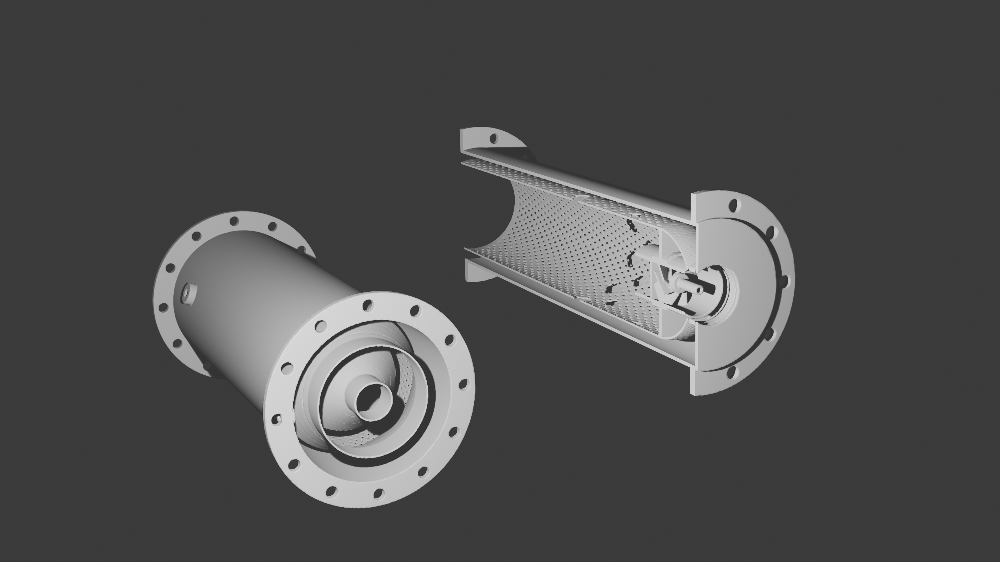

# QUASAR Phy-CB — Diseño autónomo de cámaras de combustión Brayton imprimibles en 3D

<p align="center">
  
</p>

<p align="center">
  <a href="LICENSE"></a>
  = 3.10">
  
  
  
</p>

> **Espec (~6 números, o una corrida de un hermano) → combustor físicamente
> verificado → piezas imprimibles en LPBF.** El ingeniero escribe las
> condiciones del ciclo (P₃, T₃, ṁ, T₄ objetivo, combustible, Δp/p máximo) —
> o simplemente apunta al `runs/<n>/geometry/*.json` de un compresor Quasar —
> y recibe, en el CPU de un portátil y sin proponer geometría alguna: el
> reparto de aire, el dimensionado de orificios, la atomización, el perfil
> térmico 1D del liner, el margen de LBO, emisiones en tendencia, el reporte
> HTML autocontenido, y los **STL imprimibles del liner, la carcasa, el
> swirler y los inyectores con las restricciones de fabricación aditiva
> verificadas DENTRO del lazo de optimización** — orificios de efusión
> autosoportantes, espesores por material y drenabilidad de polvo
> garantizada.
>
> Documentos que SÍ viajan en este repo:
> [docs/Quasar_PhyCB_Science.md](docs/Quasar_PhyCB_Science.md) (todas las
> ecuaciones con su estado de verificación, el estado medido de cada capa
> y los límites declarados) ·
> [docs/VALIDATION.md](docs/VALIDATION.md) (campaña de validación y
> veredicto).
> Citados en este README pero **ausentes del repo**:
> `docs/Quasar_PhyCB_Plan.md` (propuesta ejecutiva),
> `docs/PENDIENTES_Lverificar.md` (inventario por coeficiente de qué es
> sólido y qué no — su veredicto está resumido en Science §13.2 y §19),
> `docs/IMPLEMENTATION_CONTRACT.md` (el ABI congelado — θ, el record y el
> vector de restricciones están descritos en Science §1.2–1.3) y
> `docs/Quasar_PhyCB_EstadoDelArte.md`. Se citan por nombre y sin enlace,
> para que un enlace muerto no aparente ser un documento.
> Phy-CB es el tercer hermano de **Phy-CC** (compresores
> centrífugos) y **Phy-AC** (compresores axiales/fan) y comparte su
> arquitectura: *prior físico calibrado → ensemble residual con puerta de
> incertidumbre → NSGA-II restringido → informe autocontenido*.

**Léase esto antes que cualquier número de abajo:** este proyecto practica
*honestidad calibrada*. Cada cifra lleva la fidelidad de la que salió, lo
que no funciona está escrito en este README en vez de escondido, y la
sección [Limitaciones declaradas](#limitaciones-declaradas) no es una nota
al pie: es la parte que un revisor debería leer antes que la lista de
funcionalidades.

## Pipeline

```
espec (~6 números | contrato Phy-CC/Phy-AC vía --from-run)
   │   phycb_cli.py · neural_optimizer.design()            [Python, capas 1–4]
   ▼
diseño verificado (θ 20-D + record físico, schema phycb-record-1)
   │   geometry_generator.py + dfam_checker.py             [capa 5a]
   ▼
geometry/combustor.json (schema phycb-combustor-1) · hole_table.csv ·
liner_profile.csv · effusion_field.csv · combustor_bom.csv ·
cfd_boundary_conditions.json · dfam_report.json  ─────────→ report.html [5b]
   │   PhyCBImport.FromContractJson(...) + PicoGK          [capa 5c, C#/.NET 9]
   ▼
STLs de Liner + Casing + Swirler + Injector/Vaporizer (imprimibles, DfAM-verificados)
   + <Name>_field.vdb  (EL MISMO campo de vóxeles que consume la capa CFD)
   │
   └── cfd/   L1.5 LBM frío · L2a IB-RANS nativo            [primer hermano
              (L2b OpenFOAM: FUERA DE ALCANCE — contrato §12)  con CFD interno]
```

Las capas 1–5b son Python (núcleo: **solo NumPy**). La capa 5c es la
librería C# **CombustorDesigner** (.NET 9 + paquete NuGet
[PicoGK](https://picogk.org)), que convierte el diseño optimizado en las
piezas reales:

| Pieza | Archivo exportado | Contenido |
|---|---|---|
| **Liner** | `<Name>_Liner.stl` | Liner de revolución − filas de orificios − campo de efusión, domo, asientos de inyector |
| **Carcasa** | `<Name>_Casing.stl` | Casco + bridas apernadas + puertos de drenaje + boss del encendedor |
| **Swirler** | `<Name>_Swirler.stl` | Álabes por loft sobre el hub (unidos al liner cuando el contrato dice `monolithic_with_dome`) |
| **Inyector** ×N | `<Name>_Injector.stl` / `<Name>_Vaporizer{i}.stl` | Según el tipo de inyector (airblast · simplex · vaporizador · micromix) |
| **Ensamble** (vista) | `<Name>.stl` | Todo — **solo inspección, NO imprimir**; las piezas se interpenetran en sus asientos a propósito |
| **Campo de vóxeles** | `<Name>_field.vdb`, `<Name>_Liner_field.vdb` | SDF de banda estrecha OpenVDB, en mm. Es la representación nativa del kernel, así que `cfd/` muestrea el campo *idéntico* del que se malló el STL |

## Instalación

Python **≥ 3.10** y, solo para la capa 5c (las piezas imprimibles), el **SDK
de .NET 9**. El núcleo Python es **solo-NumPy**: cualquier otra dependencia
es opcional y, si falta, la pila degrada con etiqueta en `record["source"]`
en vez de fallar.

```bash
# 0. Trabaja desde la raíz del repositorio. SIEMPRE - ver la trampa de entorno.
cd "<ruta>/Phy-CB"

# 1. El mínimo que corre las capas 0-5b de punta a punta
python -m pip install -U pip
pip install numpy

# 2. Opcionales, cada uno habilita una capacidad (todos degradan con etiqueta)
conda install -c conda-forge cantera   # equilibrio real + el CRN de L1  <-- ver la regla de abajo
pip install matplotlib                 # figuras del reporte
pip install cadquery                   # exportación a STEP
pip install cupy-cuda12x               # backend GPU que cfd/ usa DE VERDAD (CUDA 12.x)
pip install "jax[cuda]" xlb            # backend XLB de L1.5 (sin él funciona el fallback NumPy/CuPy)
pip install warp-lang                  # backend L2a declarado - HOY NO se usa (el solver va sobre CuPy)
pip install pytest build               # para correr las suites bajo pytest

# 3. Capa 5c (C#, STLs imprimibles). PicoGK se resuelve como paquete NuGet.
dotnet build CombustorDesigner.sln -c Debug
```

> **Cantera en Windows: conda-forge, NUNCA pip.** El wheel de PyPI enlaza un
> LAPACK mono-hilo y las redes de reactores van 4–8× más lentas (nota oficial
> de Cantera). Regla de la casa, codificada en `pyproject.toml` y en la CI.

> **No hagas `pip install -e .` en una máquina que además tenga un proyecto
> hermano instalado.** Phy-CB, Phy-AC y Phy-CC publican módulos de primer
> nivel con los MISMOS nombres (`physics_core`, `neural_optimizer`, …), así
> que un install editable hace que `import physics_core` resuelva al `.pth`
> que gane: sin error, sin aviso, y con una respuesta plausible y
> completamente equivocada. Los grupos de dependencias están declarados en
> `pyproject.toml` (`chem`, `plots`, `cad`, `cfd`, `cfd_native`, `dev`) para
> la CI y el empaquetado; para el día a día, instala las dependencias como
> arriba y ejecuta desde esta raíz. Ver
> [Los tres hallazgos de integración](#los-tres-hallazgos-de-integración).

**Comprobar la instalación** (cada comando imprime su propio veredicto):

```bash
python phycb_cli.py --info           # entorno, escalera de fidelidad, datos provisionales
python data_pipeline.py --validate   # capa 0: 31/31 checks + manifiesto SHA-256
python test_phycb.py                 # suite de verificación: 355/355, 1 skip declarado (~35 s)
python validation/validate.py        # campaña de validación -> validation/RESULTS.md
```

> **Dependencias opcionales presentes en la máquina de referencia, medidas el
> 2026-09-10**: NumPy 2.4.6 · Cantera 3.2.0 · matplotlib 3.11 · CuPy 14.1.1
> (RTX 3070 Ti) · CadQuery 2.8.0 · JAX 0.11.0 · Pyrometheus · SDK .NET 10.
> **XLB y Warp siguen ausentes**, así que L1.5 corre sobre su fallback
> CuPy/NumPy y L2a sobre CuPy. El texto escrito antes puede decir todavía
> «sin JAX»: JAX se instaló después de aquellas medidas y ninguna de ellas
> depende de él.

## Arranque rápido

Todo lo de abajo se **corrió en esta máquina mientras se escribía este
README** (Windows 11, Python 3.13.7, NumPy 2.4.6, Cantera 3.2.0,
matplotlib 3.11, .NET SDK 10.0.100, **NVIDIA GeForce RTX 3070 Ti de 8 GiB
(cc 8.6) con CuPy 14.1.1 funcionando**; sin Warp, sin JAX, sin XLB). Las
salidas están pegadas literalmente, recortadas solo por longitud.

> **Corrección, 2026-07-31.** Una revisión anterior de este README decía
> «sin GPU» y concluía que el objetivo de rendimiento de L2a era
> inalcanzable aquí. **La premisa era falsa**: la máquina tiene una
> RTX 3070 Ti y CuPy ya estaba instalado. Las medidas en CPU eran
> correctas y se conservan; las conclusiones que se sacaron de ellas no lo
> eran, y se rehacen más abajo con medidas en GPU. El error vino de
> comprobar si estaban Warp y JAX (los dos backends que nombra
> Ciencia §11.2) y deducir «sin GPU» de su ausencia, sin mirar el hardware
> ni buscar alternativas.

> ⚠️ **Trampa de entorno — lanzar SIEMPRE desde la raíz de Phy-CB.** En una
> máquina que además tiene Phy-AC instalado como paquete *editable*, un
> `import physics_core` desde cualquier otro directorio de trabajo resuelve
> silenciosamente al de Phy-AC (física de compresor axial, NDIM = 15). Sin
> error, sin aviso, con un resultado plausible y completamente equivocado.
> Ver [Los tres hallazgos de integración](#los-tres-hallazgos-de-integración).

```bash
cd "C:/Users/nickv/projects/Proyectos/Phy-CB"
python phycb_cli.py --help          # referencia completa de flags (en inglés, regla de la casa)
```

### 1. Un diseño nominal (sin optimizador) — 17 ms de física

```bash
python phycb_cli.py --p3 250000 --t3 430 --mdot 0.13 --t4 1150 \
    --outdir runs/smoke
```

```
--- [2/4] Dimensionado nominal (capa 1, WAVE1 §3) ──────────────────────────────
  ✓ record `phycb-record-1` en 17 ms · source='correlations_L0'
  reparto de aire nominal: pz=0.300  sz=0.120  dz=0.420  cool=0.160
  driver de dimensionado: aero · A_ref=33.35 cm² · D_ref=65.2 mm

--- [3/4] Geometría, estructural y DfAM (capas 1s y 5a) ────────────────────────
  ✓ estructural · Inconel-625 · g_struct OK
  ✓ geometría   → runs/smoke\geometry\ (7 archivos, 4 filas de orificios)
  ✓ DfAM        · orientación 'z+' · voxel 0.5 mm · IMPRIMIBLE

+----------------------------------------------------------------------+
| (o) Diseño nominal                                                   |
+----------------------------------------------------------------------+
| η_comb          0.9846                                               |
| Δp/p            0.0300   (máx 0.040)                                 |
| Pattern factor  0.350   (máx 0.40)                                   |
| T pared máx     1059 K                                               |
| EI_NOx / EI_CO  2.00 / 57.57 g/kg                                    |
| φ_PZ · τ        1.048 · 6.05 ms                                      |
| Envolvente      Ø 81.5 × 166.3 mm                                    |
| T₀₄ / P₀₄       1150.0 K / 242,500 Pa                                |
| Fidelidad       correlations_L0                                      |
| Estado           FACTIBLE                                            |
| Estructura       MÁRGENES OK   Inconel-625                           |
| DfAM             IMPRIMIBLE   voxel 0.5 mm · z+                      |
+----------------------------------------------------------------------+
```

**Este estado cambió el 2026-07-31, y el porqué importa más que el
resultado.** Hasta esa fecha el ancla salía **INFACTIBLE** con
`g[8] d_eff = +0.2147`: el cociente de soplado de la efusión daba M = 1.21,
fuera del rango de validez del mapa de película, así que la eficacia
quedaba *clampeada* — es decir, inventada— y la herramienta se negaba a
llamar factible a eso.

Ese M estaba mal por un **error de geometría**, no de física: el área
mojada de la pared caliente se calculaba como `π·D_L·L_tot`, y `π·D_L` es
el perímetro de un **círculo de área equivalente**. En las arquitecturas
anulares —la del ancla lo es— el perímetro exterior real es `2π·r_lo`,
mayor en `r_lo/√(r_lo²−r_li²)` = **1.375**. Con el área correcta hay 3020
orificios en vez de 2197, M baja a **0.884** (dentro del mapa) y
`g[8] = −0.1163`. Sigue encendido el aviso BLANDO `g_soft['M_design']` =
+0.10: 0.884 está fuera de la banda de DISEÑO 0.3–0.8, y eso se dice.

La lección se conserva porque es la que da la herramienta: **el arreglo de
un g violado es un cambio de diseño, no una perilla**. Perforar más denso
sigue bajando M, y sigue chocando con la banda de efusión imprimible del
DfAM:

```bash
python phycb_cli.py --fix pitch_over_d_eff=4.5 --outdir runs/fix
```

```
  ⚠ 1 restricción(es) violada(s) de 26 — por esto NO es factible:
    g[25] dfam_effusion_band = +0.1000
```

Esta tensión entre *física de refrigeración* y *fabricabilidad* es
exactamente lo que Phy-CB existe para exponer dentro del lazo, y está
documentada de punta a punta en
`docs/PENDIENTES_Lverificar.md` §4 (§4.4
para la corrección y el movimiento del ancla).

### 2. Con la red de reactores químicos L1 (Cantera)

```bash
python phycb_cli.py --fidelity L1 --outdir runs/l1
```

```
  ✓ Cantera        · equilibrio real y CRN L1 disponibles
  ✓ Fidelidad      · se pedirá L1 y se correrá realmente en L1
  ✓ record `phycb-record-1` en 2495 ms · source='crn_L1'
```

El campo `source` dice siempre qué camino corrió de verdad. Sin Cantera el
mismo comando devuelve `crn_L1(cantera_unavailable→L0)`: degrada con
etiqueta, nunca lanza.

### 3. Optimización autónoma y el seam con los hermanos

```bash
# Corrida autónoma (NSGA-II + deep ensemble con puerta de incertidumbre):
python phycb_cli.py --optimize --quick --outdir runs/opt        # presupuesto de humo
python phycb_cli.py --optimize --rounds 5 --n-init 320 --outdir runs/full

# Tomar el punto de diseño directo del directorio de una corrida de Phy-AC / Phy-CC
# (P3/T3/mdot salen del contrato del compresor; la T4 sigue siendo tuya):
python phycb_cli.py --from-run <ruta/a/Phy-AC/runs/pr4> --t4 1250

# El ingeniero en el lazo:
python phycb_cli.py --fix swirl_SN=0.8 --fix t_liner_mm=1.0 --seed 42
python phycb_cli.py --eval-theta "2,0.70,0.30,0.12,0.42,0.70,8,10,0.6,6,2,4,0.75,1.8,0.8,0"
python phycb_cli.py --outdir runs/full --list-pareto
python phycb_cli.py --outdir runs/full --pareto-pick 3 --stl
python phycb_cli.py --outdir runs/full --resume --rounds 3
python phycb_cli.py --sweep phi_pz --outdir runs/sweep   # el "mapa" del combustor
```

Objetivos (a minimizar): **−η_comb** y **EI_NOx**. Δp/p *no* es objetivo —
en un combustor la Δp se **gasta** en mezcla hasta el máximo que permite el
ciclo, así que entra como restricción dura (`--dp-max`). El vector completo
de restricciones tiene 26 componentes: 12 aero/térmicas ⊕ 4 de spec ⊕ 5
estructurales ⊕ 5 de DfAM.

Medido con el presupuesto `--quick` (132 evaluaciones físicas, 14.5 s), y
vale la pena pegarlo porque la herramienta reporta su propio incumplimiento:

```
  ⚠ quality gate FAILED → extra round of space-filling sampling before optimizing.
⚠ el gate de calidad del surrogate NO se superó en ninguna de las 2 rondas: el
  presupuesto se gastó en muestreo espacial y NSGA-II nunca llegó a correr.
  el incumbente es el mejor punto MUESTREADO, no un óptimo del frente.

| Pattern factor  0.244   (máx 0.40)     | T pared máx  912 K                   |
| EI_NOx / EI_CO  2.71 / 40.55 g/kg      | Envolvente   Ø 65.2 × 208.3 mm       |
| Estado           FACTIBLE              | DfAM          IMPRIMIBLE             |
```

El presupuesto de humo encuentra un diseño **factible e imprimible** — pero
por muestreo espacial, no por NSGA-II: la puerta de incertidumbre del
ensemble nunca se abrió con 132 muestras, así que el surrogate nunca se
usó y el punto reportado es el mejor *muestreado*. La herramienta lo dice
en vez de presentarlo como un óptimo, y la receta de la casa (WAVE4 §7) es
enriquecer `physics_features` antes que bajar el umbral de la puerta.

**El presupuesto completo sí abre la puerta.** Medido con
`--optimize --rounds 5 --n-init 320` (460 evaluaciones físicas, 108.5 s de
optimización) — un frente de Pareto verificado de 3 puntos de verdad:

```
    #  fact arquitectura         η_comb    Δp/p     PF  T_w [K]  EI_NOx  source
    0   OK  annular              0.9846  0.0300  0.365    940.5    2.42  correlations_L0
    1   OK  annular              0.9797  0.0300  0.313   1120.2    2.12  correlations_L0
    2   OK  can                  0.9761  0.0300  0.389   1035.5    2.09  correlations_L0
```

Tres diseños factibles e imprimibles que cambian eficiencia de combustión
por NOx, con dos arquitecturas distintas elegidas por el gate θ[0]. Nótese
lo estrecho que es el eje de NOx (2.42 → 2.09): eso es la
[limitación 3](#3-la-correlación-de-nox-de-cabecera-tiene-el-signo-invertido-en-deidφ_pz)
asomando en el producto.

Control de interfaz: `--interactive`/`-i` (asistente), `--no-color`
(respeta también `NO_COLOR`), `--quiet`/`-q`.

### 4. STLs imprimibles (capa 5c)

```bash
python phycb_cli.py --p3 250000 --t3 430 --mdot 0.13 --stl --voxel 0.4
```

```powershell
# o a mano:
& "C:\Program Files\dotnet\dotnet.exe" build CombustorDesigner.sln -c Debug
& "C:\Program Files\dotnet\dotnet.exe" `
  "CombustorDesigner.Example\bin\Debug\net9.0-windows\CombustorDesigner.Example.dll" `
  runs\smoke\geometry\combustor.json output\smoke 0.4   # json, outDir, vóxel mm
#   4º argumento opcional: filtro de pieza, p. ej. "Liner" o "Vaporizer2"
```

Medido en esta máquina:

```
$ dotnet build CombustorDesigner.sln -c Debug
  CombustorDesigner -> ...\CombustorDesigner.dll
  CombustorDesigner.Example -> ...\CombustorDesigner.Example.dll
Compilación correcta.
    0 Advertencia(s)
    0 Errores
Tiempo transcurrido 00:00:01.42
```

Construido desde el contrato de la corrida de humo a 0.8 mm (~15 s de
PicoGK), esto es lo que aterriza en disco de verdad — nótese que el swirler
**no aparece como archivo aparte** porque esta arquitectura declara
`monolithic_with_dome`, así que va unido al liner:

```
PhyCB_reverse_annular_Liner.stl          38.0 MB
PhyCB_reverse_annular_Casing.stl         26.8 MB
PhyCB_reverse_annular_Vaporizer1..6.stl  0.49 MB cada uno
PhyCB_reverse_annular.stl                67.3 MB   ← ensamble, SOLO INSPECCIÓN
PhyCB_reverse_annular_field.vdb           5.9 MB   ← el SDF que lee la capa CFD
dfam_report.json                         12.7 kB   ← veredicto DfAM de as-built
```

Guía de vóxel: 0.8 mm borrador, 0.5 mm iteración, 0.3–0.4 mm final; el
coste escala como ~1/vóxel³. **Leer `dfam_report.json` antes de imprimir**
— la comprobación de as-built es más estricta que la del lazo y este diseño
la falla (ver [Limitación declarada 10](#10-el-checker-de-dfam-del-lazo-aprueba-un-diseño-que-el-de-as-built-rechaza)).

## Arquitectura por capas (el patrón CEM de la familia)

| Módulo | Capa | Rol | Estado |
|---|---|---|---|
| [`data_pipeline.py`](data_pipeline.py) | **0** | Política de capa 0: **todo coeficiente ⚠️ vive en un CSV versionado, nunca hard-coded**. 17 tablas + `data/manifest.json` con SHA-256, `REMOTE_FILES = {}` (offline deliberado). Cada tabla declara `status: verified\|provisional` y su fuente primaria | ✅ 31/31 checks · 10 verified / 7 provisional |
| [`physics_core.py`](physics_core.py) | **1** | Núcleo multi-fidelidad: `evaluate(theta, fidelity)` → `phycb-record-1`. L0 = juego completo de correlaciones de Lefebvre + equilibrio Cantera (dimensionado, reparto de aire, orificios, atomización, térmico 1D del liner, LBO, factor de patrón, abanico de NOx de 5 correlaciones); `g(θ)` ×12 continuas; 37 features físicos; hook de calibración afín hi-fi | ✅ L0 · despacho L1 · etiquetas de degradación |
| [`crn_core.py`](crn_core.py) | 1 | L1: red 1D de flujo + red de reactores químicos de Cantera (PSR + PFR), LBO por Damköhler, timeout por solve | ✅ `crn_L1` medido en 2.5 s |
| [`structures_core.py`](structures_core.py) | 1s | Biblioteca de materiales con derating térmico (9 aleaciones), tensión térmica y de aro de liner/carcasa, espesor mínimo, **regla de material prohibido en pared caliente** (`Inconel-718` por encima de 923 K). 5 restricciones duras | ✅ |
| [`dfam_checker.py`](dfam_checker.py) | 1d | **El diferenciador**: fabricabilidad LPBF como restricción de primera clase *dentro* del lazo — espesor mínimo, Ø mínimo de orificio, voladizo ≥45° o gota autosoportante, **drenabilidad de polvo** (≥2 salidas con línea de visión por cavidad), banda de paso/porosidad de efusión. 5 restricciones duras | ✅ |
| [`neural_optimizer.py`](neural_optimizer.py) | 2–4 | Deep ensemble con incertidumbre + quality gate, NSGA-II con dominancia restringida de Deb, adquisición LCB + k-means, orquestador `design(spec)` — portado de Phy-AC (núcleo agnóstico al dominio) | ✅ |
| [`geometry_generator.py`](geometry_generator.py) | 5a | Contrato `phycb-combustor-1` + `hole_table.csv`, `liner_profile.csv`, `effusion_field.csv`, `combustor_bom.csv`, condiciones de frontera de CFD, STEP opcional | ✅ 7 artefactos por corrida |
| [`report_generator.py`](report_generator.py) | 5b | Informe HTML autocontenido, 13 secciones (SVG en Python puro) + un bloque prominente de **LÍMITES DECLARADOS** con los avisos provisionales activos de *ese* record | ✅ |
| [`visualization.py`](visualization.py) | 5b | Figuras matplotlib opcionales con degradación silenciosa: `air_split`, `liner_thermal`, `liner_profile`, `emissions_fan`, `pareto` — más el juego de CFD (`generate_cfd`): corte meridional del módulo de velocidad, recirculación u_z < 0, líneas de corriente, convergencia + celdas por rasgo, y el reparto de aire *correlación vs red 1D vs medido*. La CLI las emite cuando la corrida llega a L1.5 | ✅ |
| [`cycle_seam.py`](cycle_seam.py) | 4 | `hot_cycle(record, TIT_K, ..., combustor=None)` y `cycle_adapter(record)` — el seam del ciclo Brayton caliente, implementado **del lado de Phy-CB** (ver hallazgo §0) | ✅ |
| [`cfd/xlb_cold.py`](cfd/xlb_cold.py) · [`cold_post.py`](cfd/cold_post.py) · [`crn_from_field.py`](cfd/crn_from_field.py) | L1.5 | Lattice-Boltzmann frío e isotermo sobre los vóxeles → reparto de aire real, penetración de chorros, topología de recirculación → auto-topología del CRN. Dos backends tras una sola API: XLB (ausente aquí) y un **fallback D3Q19 BGK en NumPy puro** con LES de Smagorinsky | ⚠️ corre, **no es cuantitativo a la resolución alcanzable** — ver abajo |
| [`cfd/ibrans/`](cfd/ibrans/) | L2a | RANS de frontera inmersa nativo sobre el SDF: `mesh` · `solver` · `turbulence` · `chem` · `post` · `backend` | ⚠️ **M1 hecho y verificado · M2–M4 esqueleto** — [`cfd/ibrans/ESTADO.md`](cfd/ibrans/ESTADO.md) |
| [`CombustorDesigner/`](CombustorDesigner/) + [`.Example/`](CombustorDesigner.Example/) | 5c | C# + PicoGK: contrato → liner, carcasa, swirler e inyectores como STL imprimibles; re-verifica DfAM sobre los vóxeles construidos; exporta el campo `.vdb` | ✅ compila limpio (0 warnings, 0 errores) |
| [`phycb_cli.py`](phycb_cli.py) | producto | CLI end-to-end: espec → diseño → geometría → DfAM → reporte → dataset [→ STLs] | ✅ |
| [`test_phycb.py`](test_phycb.py) | VV&UQ | Suite de verificación T1–T40 + T49, doble modo (tabla o pytest) | ✅ **359/359, 0 saltados** con `--slow` |
| [`validation/`](validation/) | VV&UQ | Campaña de validación A–F → [`validation/RESULTS.md`](validation/RESULTS.md) | ✅ corre · **107 PASS / 49 huecos declarados** |

Líneas de código (medidas): `physics_core.py` 3 742 · `test_phycb.py`
2 329 · `report_generator.py` 2 175 · `data_pipeline.py` 2 087 ·
`geometry_generator.py` 1 985 · `crn_core.py` 1 822 · `dfam_checker.py`
1 575 · `phycb_cli.py` 1 543 · `structures_core.py` 1 089 ·
`neural_optimizer.py` 928 · `visualization.py` 613 · `cycle_seam.py` 540 ·
`cli_style.py` 330 — más `cfd/` (7 974 líneas en 16 módulos: 3 163 de
L1.5, 3 237 del solver L2a, 1 574 de tests de CFD) y 12 archivos C#
(196 kB).

## La escalera de fidelidad

El contrato (`Fidelity` IntEnum) está congelado: `L0=0 · L1=1 · L15=2 ·
L2A=3 · L2B=4`. Ciencia §10 define qué *predice* cada nivel y — igual de
importante — qué **NO**. Abajo, la tercera y cuarta columnas son la
ciencia; la última es el estado de implementación **medido** en esta
máquina.

| Nivel | Coste | Predice fiable | **NO** predice | Estado de implementación |
|---|---|---|---|---|
| **L0** correlaciones + equilibrio Cantera | ~17 ms (medido) | T_ad, T₄, FAR, dimensionado, splits nominales, Δp/p, tendencias de η/PF/LBO/EI | nada espacial | ✅ **completo**. `source="correlations_L0"`, o `correlations_L0(cantera_unavailable)` en el camino solo-NumPy |
| **L1** red 1D + CRN (Cantera) | 2.5 s (medido) | splits reales 1D, τ por zona, tendencias NOx/CO (±30–50 %), LBO vía Damköhler, η_comb | PF, T de pared local | ✅ **completo**. `crn_L1`, degradando a `crn_L1(cantera_unavailable→L0)`, `crn_L1(timeout→L0)`, `crn_L1(diverged→L0)` |
| **L1.5** LBM frío sobre los vóxeles | minutos (fallback NumPy) | splits de aire 3D, penetración de chorros, topología de recirculación → auto-topología del CRN | todo lo térmico (densidad por zona corregida desde L0) | ⚠️ **implementado y corre, pero NO es cuantitativo a la resolución alcanzable en CPU** — ver [Limitaciones declaradas](#4-l15-es-topológico-no-cuantitativo) |
| **L2a** IB-RANS nativo sobre el SDF | 5–30 min *en GPU* | topología de flujo, penetración de dilución, **ranking de PF y puntos calientes entre diseños**, Δp/p ±15–20 %, T₄ ±3–5 % | NOx absoluto (×2–10), PF absoluto, LBO cuantitativo, termoacústica, **T de metal cuantitativa** | ⚠️ **M1–M3 HECHOS y verificados con V&V; M4 implementado pero NO cerrado.** `solve()` ya devuelve el producto del §4.4 (o `None` con un `DEGRADE_TAG` etiquetado), pero el caso ancla aún no supera T₄ ±5 % y no admite contraste de Δp/p — ver `cfd/ibrans/ESTADO.md` §12 |
| **L2b** OpenFOAM `reactingFoam` | 0.5–12 h | lo de L2a + CHT + radiación ⇒ la *T de metal cuantitativa* | NOx absoluto | ❌ **FUERA DE ALCANCE** (contrato §12). El valor del enum se conserva — es ABI — y `--fidelity L2B` degrada con `source="openfoam_L2B(out_of_scope→…)"` |

### Hito M1 del L2a — la escalera V&V pasa entera, sin aflojar un umbral

Medido con `python -m pytest cfd/tests/test_ibrans_v1_v3.py -q` y los dos
scripts manuales de los casos caros. Los umbrales son los que fijó Ciencia
§13.1 *antes* de las corridas:

| Caso | Referencia | Criterio | Medido |
|---|---|---|---|
| V1a Poiseuille, las dos paredes inmersas y desplazadas 0.25 dx | analítica | < 2 % | **0.17 %** ✅ |
| V1b Couette, pared inmersa móvil | analítica | < 2 % | **0.04 %** ✅ |
| V2 cavidad de tapa deslizante, Re = 100 (32²) | Ghia et al. 1982 | máx\|Δu\| < 0.05 | **0.0044 / 0.0070** ✅ |
| V2 cavidad de tapa deslizante, Re = 1000 (128²) | Ghia et al. 1982 | máx\|Δu\| < 0.05 | **0.0048 / 0.0099** ✅ |
| V3 cilindro en flujo cruzado, C_d (D/10) | 1.35 (Liu 1998) | ±10 % | **1.3958 → +3.4 %** ✅ |
| V3 cilindro en flujo cruzado, Strouhal (D/10) | 0.165 (Williamson 1989) | ±10 % | **0.16638 → +0.8 %** ✅ |

Los dos casos caros **no son skips silenciosos**: se corrieron, pasan, y
viven en `PHYCB_SLOW=1` más `cfd/tests/run_v2_re1000.py` /
`run_v3_cylinder.py`. Re-corrida entera mientras se escribía este README —
`python cfd/tests/test_ibrans_v1_v3.py --slow` — la escalera está en verde:

```
  [OK  ] V1a   Poiseuille laminar, paredes inmersas          13.0 s
  [OK  ] V1b   Couette, pared inmersa movil                  13.2 s
  [OK  ] V2a   Cavidad Ghia Re=100 (32^2)                    18.8 s
  [OK  ] V2b   Cavidad Ghia Re=1000 (128^2) [lento]         872.1 s
  [OK  ] V3a   Cilindro IB malla mini (St)                   16.0 s
  [OK  ] V3b   Cilindro IB D/10 (Cd y St) [lento]           539.3 s
  [OK  ] M0a   distancia a pared = |phi| exacta               0.0 s
  [OK  ] M0b   L2A degrada etiquetado (contrato §3)           2.8 s
  [OK  ] M0c   M2/M3 declaran su ausencia                     0.0 s
  TODO EN VERDE
```

La historia completa — incluidos los dos bugs reales
que cazó la escalera (un volumen de fluido sellado que hacía el residual
*idénticamente cero*, es decir un solver «convergiendo» sin mover nada, y
un Newton de la ley de Spalding sustituido por bisección acotada) — está en
[`cfd/ibrans/ESTADO.md`](cfd/ibrans/ESTADO.md).

**El objetivo de rendimiento de M1 SÍ se cumple — en GPU.** WAVE6 pide
500 k celdas × 10 k iteraciones en 5–40 min. Ciencia §11.2 nombra Warp y
JAX como backends; no está ninguno de los dos. Pero **CuPy sí está**, es un
reemplazo casi directo de NumPy y no exige instalar nada. Medido con el
solver real mediante `python cfd/tests/run_perf_budget.py`:

| Caso | Celdas | NumPy/CPU s/celda/paso | CuPy/GPU s/celda/paso | ganancia |
|---|---|---|---|---|
| referencia pública GPU FP32 (JAX-Fluids) | — | — | 1e-8 | — |
| 3D n=32, RK3 | 32 768 | 4.94e-7 | 1.34e-6 | **×0.4 (gana la CPU)** |
| 3D n=40, RK3 | 64 000 | 4.87e-7 | 6.60e-7 | ×0.7 |
| 3D n=60, RK3 | 216 000 | 1.83e-6 | 1.99e-7 | ×9.2 |
| **3D n=80, RK3** | **512 000** | **1.84e-6** | **8.65e-8** | **×21.2** |
| 3D n=128, RK3 | 2 097 152 | 1.84e-6 | 5.02e-8 | ×36.7 |

**Veredicto sobre el caso objetivo: NumPy 2.55 h (no se cumple) · CuPy
4.2 min (se cumple).** La GPU queda a ×5–8 de la referencia pública FP32,
no a ×270.

Dos matices medidos que conviene conservar:

* **Por debajo de ~100 k celdas gana la CPU** (cruce medido entre 64 k y
  141 k): a 32 k celdas la GPU va ×0.4, es decir *más lenta*, porque manda
  la latencia de lanzamiento de kernels. El backend `auto` se queda en
  NumPy por debajo de `GPU_MIN_CELLS = 100_000` justamente por eso.
* **Los números se mueven si la GPU está compartida.** El mismo caso de
  512 k midió 1.17e-7 s/celda/paso con la tarjeta libre y 2.01e-7 con otro
  trabajo ocupándola al 99 %. Ambos figuran en
  [`cfd/ibrans/ESTADO.md`](cfd/ibrans/ESTADO.md) §5.

Lo que esto **no** cambia: M2/M3/M4 siguen siendo esqueleto y `solve()`
sigue devolviendo `None` a propósito. Tener un backend rápido quita el
bloqueo de *cómputo* para M2/M3, no el trabajo de modelado.

## Estado por wave

| Wave | Entregable | Estado | Evidencia |
|---|---|---|---|
| **W0** Setup y convenciones | contrato `evaluate()`, θ, copias verbatim de `neural_optimizer`/`cli_style`, T1–T5 | ✅ **hecho** | T1–T5 en verde, incluido el centinela de procedencia (T1) |
| **W1** Núcleo L0 | Lefebvre + Cantera + térmico 1D + emisiones + reporte + capa 0 | ✅ **completa · ❗ NO CERRADA** | 17 tablas de capa 0 con SHA-256; pero 17 de 19 coeficientes ⚠️ siguen provisionales y **ninguno** se ha cotejado contra la fuente canónica. Veredicto y checklist: `docs/PENDIENTES_Lverificar.md` §7 |
| **W2** CRN L1 + estructural | red 1D, CRN de Cantera, `structures_core` | ✅ **hecho** | T17–T24; `source='crn_L1'` medido en 2 495 ms |
| **W3** Geometría + DfAM | `phycb-combustor-1`, C#/PicoGK, checker DfAM | ✅ **hecho** (con un hallazgo real) | T25–T31 (T29 = smoke real de C#/PicoGK, corre con `--slow`); la solución compila con 0 warnings; STLs + `.vdb` generados e inspeccionados. El DfAM de vóxel de **as-built** rechaza la carcasa del ancla por voladizo a 0.8 y a 0.4 mm — [limitación 10](#10-el-checker-de-dfam-del-lazo-aprueba-un-diseño-que-el-de-as-built-rechaza) |
| **W4** Optimizador + integración | `design(spec)`, `--from-run`, `combustor=` en `hot_cycle` | ✅ **hecho** | T32–T40, incluido el end-to-end T40 (7/7) y el g global de 26 componentes; una corrida con presupuesto completo (460 evals) produce un frente de Pareto verificado real de 3 puntos |
| **W5-A** L1.5 XLB → auto-CRN | LBM frío, post-proceso frío, auto-topología del CRN | ⚠️ **implementada y corriendo, INCUMPLIENDO su propia aceptación** | `test_cfd_l15.py --slow`: T41 ✓ · T42 ✓ · **T43 ✗** (J=4 en +30.4 % frente al ±25 %) · **T44 ✗** (splits del ancla muy fuera, Δp/p ×123, sin converger) · **T45 ✗** (comparte el campo de T44). Diagnóstico y números: [limitación 4](#4-l15-es-topológico-no-cuantitativo) |
| **W5-B** L2b OpenFOAM | — | ❌ **fuera de alcance** (contrato §12) | T46–T48 son SKIP declarados, jamás verdes falsos |
| **W6** CFD nativo L2a | IB-RANS en 4 hitos | ⚠️ **M1–M3 hechos y verificados · M4 implementado, no cerrado** | V1–V7 pasan; M4 corre de punta a punta y la llama **ancla en el combustor real** (riesgo #1 resuelto), pero T₄ sale a +25.7 % del balance y Δp/p no es comparable con la red 1D mientras no se resuelva el anillo liner–carcasa (pide dx ≤ 1 mm). Números y diagnóstico: `cfd/ibrans/ESTADO.md` §12 |
| **W7** V&V y validación | campaña, anclas, CI, VALIDATION.md | ✅ **corrida, reproducible, y ha encontrado cosas** | 107 PASS / 49 huecos documentados (G1–G15); ancla `REF_CB10` reproducida bit a bit |

**Verificación frente a validación** — la familia las mantiene
estrictamente separadas:

| | Pregunta | Dónde | Medido hoy |
|---|---|---|---|
| **Verificación** | ¿resolvemos *bien* las ecuaciones? | `test_phycb.py` (T1–T40, T49) + la escalera V1–V9 del CFD | `python test_phycb.py` → **355/355 OK, 1 skip declarado, 34 s**; `--slow` → **359/359 OK, 0 saltados, 38 s** |
| **Validación** | ¿son las ecuaciones *correctas*? | `validation/` → [`docs/VALIDATION.md`](docs/VALIDATION.md) | `validate.py` → **PASS 107 · FAIL 48 (48/48 huecos conocidos y documentados) · N/E 1** (medido el 2026-09-10) |

La respuesta corta de la propia campaña, citando `docs/VALIDATION.md` §1:
Phy-CB acierta la cadena **reparto de aire → φ_PZ** contra la única máquina
real con dos puntos publicados (**+1.55 % y +0.20 %**, sin recalibración
por máquina). Todo lo demás está sin anclar: cinco constantes gobiernan los
números de portada y tres están calibradas a UN solo punto.

## Limitaciones declaradas

Esta sección es deliberadamente larga, deliberadamente cerca del principio,
y deliberadamente sin suavizar.

### 1. No hay temperatura de metal cuantitativa en ningún nivel de fidelidad

L2b (OpenFOAM, CHT + radiación, error ≤10 % documentado) era el nivel que
iba a darla. Está **fuera de alcance** porque la máquina objetivo es
Windows y OpenFOAM exigiría WSL2 o Docker (contrato §12). Esa capacidad
**desapareció del sistema; no se trasladó a otro sitio**:

> Phy-CB no predice temperatura de metal cuantitativa en ningún nivel de
> fidelidad. El térmico 1D del liner (L0) da la *tendencia* y el *margen*
> frente al límite del material; L2a dará mapas de pared **adiabática**
> para *ranking* entre diseños. Cerrar el hueco exige banco de ensayo
> (nivel F de validación) o reactivar L2b en una máquina con WSL2/Docker.

Cuánto importa está medido, no afirmado: en el caso de validación D1
(Bath/HiETA, T₃ = 1093 K) el modelo declara que el **Inconel 625 no
aguanta** (T_w1 = 1466 K frente a un límite de 1253 K) — y Bath/HiETA
fabricó y operó ese combustor en Inconel 625. Ese es el hueco **G12**, la
falsación más limpia de la campaña, y es robusto frente a 18 combinaciones
de reparto de aire y número de orificios.

### 2. El NOx absoluto no se promete nunca

Ni en L0, ni en L1, ni en L2a. Las emisiones se entregan como **tendencia
y orden de magnitud (×2)**, y toda cifra de L2 lleva pegada la etiqueta
*«comparación de diseños / detección de puntos calientes — no apto para
certificación de emisiones»*.

### 3. La correlación de NOx de cabecera tiene el signo INVERTIDO en dEI/dφ_PZ

Esta merece su propio encabezado porque **EI_NOx es objetivo del
optimizador**.

`record["EI_NOx"]` es hoy `EI_NOx_lefebvre`. La forma de Lefebvre usa la
**temperatura estequiométrica fija** T_st dentro del exponencial y la
**temperatura de zona primaria** en el denominador, así que en realidad no
depende de φ_PZ; la pendiente de −25 % que se ve en un barrido por el lado
pobre es puro artefacto del denominador (gramos de NOx *por kg de
combustible*, y el gasto de combustible se mueve con η_comb). Barrido
medido:

| φ_PZ | **lefebvre (cabecera)** | zonal | odgers | laviolette |
|---|---|---|---|---|
| 0.604 | 2.619 | 0.013 | 0.527 | 0.023 |
| 0.797 | 2.221 | 1.048 | 3.251 | 0.544 |
| **1.048** | **2.000** | **3.756** | **8.911** | **3.172** |
| 1.260 | 2.102 | 0.246 | 5.594 | 1.405 |
| 1.599 | 2.376 | 0.000 | 1.597 | 0.157 |

Las tres formas **zonales** dan el signo correcto *y* el pico en
φ_PZ ≈ 1.05, justo donde está el máximo de T_ad. La cabecera no. Cualquiera
puede reproducirlo con un comando — `python phycb_cli.py --sweep phi_pz`
escribe `sweep_phi_pz.csv` con la geometría congelada:

| φ_PZ | 0.632 | 0.766 | 0.932 | **1.048** | 1.198 | 1.402 | 1.704 | 2.221 |
|---|---|---|---|---|---|---|---|---|
| **EI_NOx** (cabecera) | 2.550 | 2.273 | 2.056 | **2.000** | 2.058 | 2.210 | 2.469 | 2.764 |
| EI_CO | 263.8 | 135.4 | 70.0 | **57.6** | 70.6 | 113.6 | 220.9 | 400.2 |

El NOx de cabecera tiene su **mínimo justo en φ_PZ ≈ 1.05** — el punto
donde la temperatura adiabática de llama es máxima y el NOx térmico debería
estar en su *máximo*. (El EI_CO, en cambio, sí toca fondo ahí, que es lo
correcto.) Es decir: como objetivo del optimizador, `EI_NOx` lleva el
**gradiente equivocado** respecto de φ_PZ.

Qué le hace eso a una corrida real en 20-D es otra pregunta, y hay que
medirla, no inferirla. Medido, con el presupuesto completo (460
evaluaciones, 5 rondas): el frente de Pareto verificado son 3 puntos
factibles que abarcan **EI_NOx 2.42 → 2.09 g/kg** mientras η_comb va de
0.9846 a 0.9761. Una dispersión del ±7 % en el objetivo de NOx a lo largo
de todo el frente es el síntoma práctico del mismo defecto: **la forma de
Lefebvre apenas depende del diseño, así que como objetivo casi no
discrimina.** (El punto recomendado cae en φ_PZ = 0.616 con EI_CO =
214 g/kg, ×3.7 los 57.6 del diseño nominal: el frente está comprando su
pequeña ganancia de NOx con una penalización grande de CO que ningún
objetivo está vigilando.)

Es el hueco **G13**, es la prioridad nº 1 de la lista de recalibración
y — cosa rara — no cuesta ningún dato nuevo: es una decisión de modelo,
una línea de `physics_core.py`. Se documenta en vez de parchearse en
silencio porque cambiar la clave de cabecera del record mueve el ancla
congelada `REF_CB10`, y la regla de la casa es que mover un ancla es un
acto deliberado (`--freeze-anchors`) que cita la corrección que la movió.

Dos hallazgos acompañantes: **G14** — la forma *global* de Rizk & Mongia es
insensible a φ_PZ por construcción (0.00 % en todo el barrido); **G15** —
la forma *zonal* es insensible a τ (< 2 %). Para tendencia en φ, la zonal;
para tendencia en τ, Odgers o Lefebvre.

### 4. L1.5 es topológico, no cuantitativo

El nivel de LBM frío corre en esta máquina por el fallback D3Q19 en NumPy
puro. El nivel resuelve su backend como XLB → **CuPy (GPU)** → NumPy y
etiqueta cuál salió. XLB no está instalado; CuPy sí, así que el ancla corre
ya en GPU a **193 MLUPS (5.17e-9 s/celda/paso)**, que bate la referencia de
1e-8 de Ciencia §11.2.

**Eso compró resolución, y la resolución no era la restricción que
mandaba.** El ancla pasó de 0.92 M nodos a dx = 1.229 mm (anillo de 2.0
celdas) a **6.98 M nodos a dx = 0.613 mm** (anillo 4.0 celdas, Ø mínimo
8.4 celdas), y *convergió*: 37 800 pasos, 1 365 s. Los tests de aceptación
siguen fallando, y el diagnóstico cambió:

> **τ sigue suelado en `TAU_FLOOR` = 0.5015 frente a un molecular de
> 0.50001–0.50003, así que la viscosidad efectiva es ×53–106 la real y
> Δp/p sale 0.587 contra un diseño de 0.030.** Afinar la malla redujo el
> cociente de viscosidad a la mitad y no lo arregló. Lo que hace falta es
> un operador de colisión que aguante τ → 0.5 (MRT/TRT/BGK regularizado),
> **no más celdas.**

Una revisión anterior de este archivo predecía que «con dx ≤ 0.6 mm sería
cuantitativo». Esa predicción está ahora **refutada por medida**, y se deja
escrito aquí en vez de retirarlo en silencio. El límite que queda en pie:

> **El campo frío de L1.5 sirve para TOPOLOGÍA — estructura de
> recirculación, por dónde se va el aire, auto-topología del CRN — y NO es
> cuantitativo.**

Y eso no es una predicción: es lo que miden sus tests de aceptación.
`python cfd/tests/test_cfd_l15.py --slow` en esta máquina:

| Check | Criterio | Medido | |
|---|---|---|---|
| **T43** chorro en flujo cruzado, J = 4 | Y/d dentro del ±25 % de 1.15·√J | Y/d 3.00 vs 2.30 → **+30.4 %** | ✗ |
| T43, J = 16 | ±25 % | 5.20 vs 4.60 → +13.0 % | ✓ |
| T43, J = 36 | ±25 % | 6.70 vs 6.90 → −2.9 % | ✓ |
| T43 monotonía | Y/d crece con J | 3.00 → 5.20 → 6.70 | ✓ |
| **T44** splits del ancla KJ66 vs la red 1D de L1 | por zona \|LBM − red\| < 20 % | pz −22.5 % · sz **−62.1 %** · dz **−51.4 %** · cool **+242.5 %** | ✗ |
| T44e cierre de masa entrada/salida del LBM | < 1 % | 1.013 % | ✗ |
| T44g Δp/p del LBM frente al de diseño | < ×3 | **3.70 vs 0.030 → ×123** | ✗ |
| T44h estacionario estadístico | convergido | **no convergido en 9 400 pasos** | ✗ |
| **T45** CRN de auto-topología vs el manual | mismas tendencias de NOx | arrastrado por T44 — comparte el campo | ✗ |

**El porqué, medido en vez de razonado.** La malla del ancla sale
69 × 69 × 193 = **918 873 nodos a dx = 1.229 mm** (el presupuesto de nodos
está acotado; más fino son más nodos de los que NumPy puede cargar). A esa
resolución:

* τ queda suelado en `TAU_FLOOR = 0.5015` cuando el molecular sería
  0.5000138 — así que la **viscosidad efectiva es ×109 la real**, y el
  Reynolds del cálculo es **≈ 6 627 frente a un físico de 722 548**.
* La pared del liner tiene **0.80 mm de espesor, menos que una celda de
  1.229 mm.** Hubo que **forzar a sólido 27 188 celdas de gas** (9.6 % del
  volumen del liner) para sellarla — sin eso el liner tiene fugas y los
  splits medidos son basura. Ese sellado es en sí mismo una distorsión
  declarada.
* Los orificios de efusión (Ø 0.6 mm) son irresolubles y entran como
  transpiración distribuida; su cantidad de movimiento no se modela.

El chorro débil (J = 4) es justo el caso que un campo demasiado viscoso
mantendría erguido de más, y es el que falla; los chorros fuertes (J = 16,
36), dominados por cantidad de movimiento y no por difusión, pasan. Ese
patrón es la firma del límite de resolución, no de un error de código — y
la estación de semejanza de T43 se derivó **a priori** de la trayectoria
clásica (1.6·s₀^⅓ = 1.15 ⇒ s₀ = 0.371) y **no se movió para aprobar el
test**.

Un campo del ancla cuesta **2 378 s (~40 min) a 3.63 MLUPS** en este CPU.
Así que el resumen honesto de W5-A: la fontanería está completa y el camino
de auto-CRN funciona de punta a punta, pero **los números que produce no
cumplen los criterios de aceptación de la propia wave, y se reportan como
fallando en vez de re-ajustarse hasta cumplir.**

### 5. Δp/p se impone, no se predice (en L0)

`record["dp_over_p"]` reproduce el objetivo **por construcción**: las áreas
de los orificios se dimensionan para cumplirlo. En microturbina Δp/p es
restricción dura del ciclo, no una salida. Validarlo exige `dp_over_p_cfd`
de L1.5/L2a. El criterio v1 «Δp/p ±20 %» es por tanto **no evaluable** hoy,
y `docs/VALIDATION.md` §3 lo dice.

### 6. El factor de patrón devuelve su propia calibración

PF = 0.35000 en los seis casos de validación, en tres clases de potencia y
en los dos puntos del KJ66. `PF = exp[−k·(L_DZ/D_L)·(ΔP_L/q_ref)]` con `k`
ajustada a **un** punto, y con el criterio aerodinámico de dimensionado
`ΔP_L/q_ref = 15` es una identidad algebraica — así que al PF no le queda
ningún grado de libertad que dependa del caso. **El PF no está validado**
(hueco G5).

### 7. El LBO no está validado, y con airblast los números no son creíbles

φ_LBO ∝ D₃₂², y el SMD de airblast sale ×3–4 pequeño frente a la banda de
clase, produciendo márgenes de LBO de **×42 (A2) y ×476 (D1)**. Un margen
de ×476 dice «esta cámara no se apaga jamás»: eso es un síntoma, no un
resultado (hueco G8). Los casos con vaporizador se salvan porque su SMD es
el d₅₀ = 50 µm verificado del KJ66, no una correlación.

### 8. Coeficientes provisionales abiertos — 42 avisos llegan a los números del ancla

La capa 0 tiene **17 tablas**; 7 llevan `@status: provisional` a nivel de
tabla y **107 de 368 filas con columna de estado** están marcadas
provisionales. En el ancla `REF_CB10` llegan **42 avisos** a un número
reportado, viajan dentro del record bajo `limitations` y se imprimen en
todo `report.html`.

**Cero coeficientes se han cerrado contra la fuente primaria canónica**
(Lefebvre & Ballal, 3.ª ed. — el libro no está disponible en esta máquina).
Cinco de ellos mueven un número de portada más de un 20 %, con el
movimiento **medido** perturbando la tabla de capa 0 y reevaluando el
ancla:

| Coeficiente | Qué mueve | Movimiento medido |
|---|---|---|
| `EPS_G_FLOOR_LUMINOUS = 0.15` (calibración de la casa) | `T_wall_max_K` | barriendo la banda de literatura 0.05–0.60 → **808 K ↔ 1573 K**, y `g[1]` **cambia de signo** |
| `rad_internal_prefactor = 0.50` | T_w1 | ×2 → 1302.6 K (+23.0 %) |
| `k_dilution = 0.0388823` (ajustada a un punto) | PF | ×0.5 → 0.592 (+69 %); ×2 → 0.1225 (−65 %) |
| `C_LBO_SI` (ajustada a un punto, ±45 % declarado) | φ_LBO, margen de LBO | ±45 % → margen **0.378 ↔ 2.634** |
| Carta η_c(θ) (un punto de anclaje, forma de la casa) | todo el dimensionado | si la carta real exigiera θ ×2: A_ref **+58.8 %**, V_c y τ **×2**, D_casing +26 % |

Dos de estos son *autorreferenciales en el ancla*: la k del PF y C_LBO
están calibradas al propio ancla, así que en el ancla no predicen —
devuelven su calibración.

El inventario completo, con el impacto por coeficiente y qué haría falta
exactamente para cerrarlo, está en
`docs/PENDIENTES_Lverificar.md`. **WAVE1
queda declarada COMPLETA pero NO CERRADA** precisamente por esto.

### 9. La tabla de referencia por clase se contradice a sí misma

La campaña de validación encontró que `data/reference/class_table.csv` — el
ancla número uno del plan de validación — es **internamente
inconsistente**: el balance de entalpía (álgebra pura, sin ningún
coeficiente provisional dentro) aplicado a las propias bandas de (T₃, T₄)
de la tabla impone un FAR que no solapa con la banda de FAR que la tabla
declara, y en la clase 0 (no recuperada por definición) es directamente
imposible. Ese único defecto de dato explica **17 de los 49 FAIL**. La
acción es **corregir el DATO, no el modelo**: calibrar contra un dato
inconsistente es el peor movimiento posible en una campaña de validación
(hueco G1).

### 10. El checker de DfAM del lazo aprueba un diseño que el de as-built rechaza

Hay **dos** comprobaciones de fabricabilidad, y en el diseño ancla no se
ponen de acuerdo. `dfam_checker.check()` (Python, 5 restricciones
analíticas, lo bastante barato como para vivir dentro del lazo del
optimizador) declara el diseño de humo **IMPRIMIBLE**. `DfamVoxelCheck`
(C#, 3 restricciones medidas sobre los **vóxeles construidos** después de
que PicoGK haya hecho la pieza de verdad) lo declara **FAIL**. Medido,
construyendo el mismo contrato dos veces:

```
$ ...CombustorDesigner.Example.dll runs/smoke/geometry/combustor.json out 0.8
DfAM VIOLATION - overhang: part 'Casing' has 2.359 % of its solid cells with no
  support within 45 deg beneath them in build 'z+' (tolerance 0.5 %)
DfAM voxel verdict: FAIL  g = [+3.7179, -1.0000, -1.0000]
WARNING liner wall: thickness clamped 0.8 -> 1.6 mm (2 voxels at 0.8 mm).
  The PRINTED part is thicker than the verified design.

$ ...el mismo contrato, vóxel 0.4
DfAM VIOLATION - overhang: part 'Casing' has 2.366 % ...
DfAM voxel verdict: FAIL  g = [+3.7311, -1.0000, -1.0000]
  (sin avisos de clamp de espesor a 0.4 mm)
```

Son dos cosas distintas, y el par de corridas las separa:

* **La violación de voladizo de la carcasa es REAL, no un artefacto de
  discretización.** Partir el vóxel por la mitad la mueve de 2.359 % a
  2.366 %, es decir, nada. La carcasa tiene de verdad superficies de
  down-skin por debajo de 45° en la construcción `z+`. El checker analítico
  no lo caza porque razona sobre el *contrato*, no sobre el sólido barrido.
* **El clamp de espesor SÍ es un artefacto de discretización.** A vóxel
  0.8 mm la pared de liner de 0.8 mm y los álabes de swirler de 1.2 mm se
  clampean a 1.6 mm (suelo de 2 vóxeles), así que **la pieza impresa no es
  el diseño verificado**; el aviso lo dice explícitamente, y a 0.4 mm
  desaparece. Las piezas finales se imprimen a 0.3–0.4 mm, nunca a
  resolución de borrador.

El propio reporte de C# enuncia la relación — *«COMPLEMENTARY to
`dfam_checker.check()`: those 5 analytic constraints pre-filter the contract
inside the optimizer loop; these 3 are measured on the built voxels.
Neither replaces the other.»* Es el encuadre correcto, pero la consecuencia
práctica es cruda: **un diseño que el optimizador llama imprimible puede
seguir fallando la comprobación de as-built, así que hay que leer el
`dfam_report.json` de la capa 5c antes de mandar nada a una impresora.**

### 11. Otros límites declarados

* **L2a cumple su objetivo de rendimiento en GPU y lo incumple en CPU**:
  el caso de 500 k × 10 k de la wave son 4.2 min con CuPy y 2.55 h con
  NumPy. Por debajo de ~100 k celdas la CPU es más rápida y `auto` se queda
  ahí. Números en
  [la escalera de fidelidad](#hito-m1-del-l2a--la-escalera-vv-pasa-entera-sin-aflojar-un-umbral).
* **L1.5 no es cuantitativo, y más malla no lo arregla.** El operador de
  colisión BGK suelado en `TAU_FLOOR` limita el Reynolds alcanzable; el
  ancla a dx = 0.613 mm sigue dando Δp/p ×20 fuera del diseño. La tarea
  abierta es un operador robusto en τ (MRT/TRT), no más celdas.
* ~~**Dos módulos no coinciden en el área de paso de la efusión para la misma
  geometría**~~ — **ARREGLADO el 2026-07-31.** El LBM leía 854.1 mm² del
  contrato y `crn_core` 621.4 mm² del record, con dos C_d distintos (0.221 vs
  0.247): ×1.54 de conductancia al mismo Δp. Causa raíz: `π·D_L` es el
  perímetro de un **círculo de área equivalente** y solo vale para `can`; en
  una corona el perímetro exterior real es `2π·r_lo`, mayor en
  `r_lo/√(r_lo²−r_li²)` = 1.375 en el ancla. Hoy hay **una sola** fuente
  (`physics_core` §12.b: `effusion_wall_area_m2`, `effusion_pattern`,
  `effusion_discharge_coefficient`), `geometry_generator` contrasta su área
  real contra la nominal y registra la discrepancia como violación del
  contrato entre capas, y el test **T49** lo vigila para las tres
  arquitecturas. Detalle y movimiento del ancla en
  `docs/PENDIENTES_Lverificar.md` §4.4.
* **La puerta de incertidumbre del surrogate no se abre con el presupuesto
  `--quick`.** Medido: 132 evaluaciones físicas en 2 rondas, puerta cerrada
  las dos veces, así que NSGA-II nunca corrió y el incumbente reportado es
  el mejor punto *muestreado* (la CLI lo dice en pantalla). Con el
  presupuesto completo — 460 evaluaciones, 5 rondas — **sí** se abre y
  produce un frente de Pareto real de 3 puntos. Que la puerta se cierre es
  la puerta *funcionando*: se niega a confiar en un ensemble que no se lo
  ha ganado. Pero implica que las corridas de humo son búsqueda por
  muestreo espacial, no optimización, y no deben citarse como resultados
  optimizados.
* La **termoacústica** está fuera del alcance de L0–L2. Mitigación pasiva
  (resonadores de Helmholtz integrables por AM) más ensayo en banco;
  declarado.
* El **STL de ensamble es solo para inspección** — imprimir las piezas.
* Los materiales llevan valores típicos de handbook; sustituir por specs
  certificadas para diseño real.
* La calibración afín hi-fi (`HiFiCalibration`) sigue en la **identidad**:
  necesita ≥2 pares hi-fi y hoy hay **cero** (no hay producto L2a, ni L2b,
  ni banco). La campaña corre a propósito con `calibrate=False` — con la
  afín activa estaríamos validando la calibración, no la física.
* La efusión de L1.5 (Ø 0.6 mm) es **irresoluble** a dx ≥ 1 mm y entra como
  transpiración distribuida gobernada por el Δp local que el LBM sí
  resuelve.
* `cfd/ibrans` todavía no lee el `.vdb` de PicoGK (no hay binding de
  OpenVDB para Windows/CPython 3.13); usa un SDF analítico aproximado del
  conducto anular del liner — **sin swirler, sin orificios, sin domo**. Es
  la tarea 4.1 de M4.

## Los tres hallazgos de integración

Tres descubrimientos durante la implementación cambiaron el plan. Están
congelados en
`docs/IMPLEMENTATION_CONTRACT.md`.

### §0 — `Phy-AC/fan_core.py` no existe en el repo

El documento de contexto de integración describía `fan_core.hot_cycle()`
con números de línea concretos. **Ese archivo no está en el repo.** Ningún
módulo de la copia de Phy-AC define `hot_cycle`, `GAMMA_HOT`, `CP_HOT`,
`ETA_COMB`, `DP_COMB`, `LHV_JET_A` ni `BPR`.

Decisión: Phy-CB implementa el seam **de su lado**, en
[`cycle_seam.py`](cycle_seam.py) — una reimplementación byte-fiel de las
fórmulas documentadas con el parámetro `combustor=` ya soportado, más
`cycle_adapter(record)`. Con `combustor=None` reproduce exactamente el
relleno constante documentado. **No se modificó ningún archivo de Phy-AC ni
de Phy-CC**; hay un hook (`_import_phyac_fan_core()`) listo para delegar el
día que Phy-AC gane su propio `hot_cycle`.

### §0.b — Phy-AC ensombrece los módulos de Phy-CB (el silencioso)

Phy-AC está instalado como paquete **editable** en esta máquina
(`__editable__.phyac-0.1.0.pth`). Por tanto:

```
$ cd /cualquier/otro/sitio && python -c "import physics_core; print(physics_core.NDIM)"
15        # ← el physics_core de Phy-AC. Física de compresor axial.
```

Sin error. Sin aviso. Un resultado plausible y completamente equivocado.
Regla obligatoria para **todo** punto de entrada (CLI, `test_phycb.py`,
`validation/*.py`, `cfd/tests/*`, cualquier `__main__`):

```python
import os, sys
sys.path.insert(0, os.path.dirname(os.path.abspath(__file__)))
import physics_core as pc
pc.assert_provenance(pc, sc, gg, ...)   # ImportError ruidoso si algún módulo no es de Phy-CB
```

`physics_core.PROJECT == "Phy-CB"` es el centinela. Es la **única excepción
deliberada a la regla de degradar-nunca-fallar del núcleo**: una
dependencia mal resuelta no es un caso degradable, es un bug de entorno que
debe parar la ejecución. El test T1 falla si `physics_core.__file__` no
cuelga del directorio de Phy-CB.

### §12 — L2b (OpenFOAM) queda fuera de alcance, y se lleva una capacidad con él

Máquina objetivo Windows ⇒ OpenFOAM exigiría WSL2/Docker ⇒ el backend sería
código no ejecutable en la máquina objetivo, y esta casa no entrega números
que no puede correr. `Fidelity.L2B` **se conserva** en el enum a propósito
(es parte del contrato de datos: aparece en `record["fidelity"]`, en los
checkpoints y en `phys_cache.jsonl`; renumerarlo invalidaría artefactos ya
escritos) y `--fidelity L2B` degrada con un `source` etiquetado. La
consecuencia sobre las promesas del sistema es la
[Limitación declarada nº 1](#1-no-hay-temperatura-de-metal-cuantitativa-en-ningún-nivel-de-fidelidad).

### Bugs que destaparon las propias suites (y cuáles fueron)

Se encontraron y corrigieron cuatro defectos reales gracias a los tests del
propio proyecto. Se listan aquí porque «los tests no encontraron nada»
suele ser una afirmación sobre los tests:

1. **El checker de voladizos de C# eximía la rodaja equivocada.** La
   exención «on the build plate» comparaba con `s == 0`, pero la rejilla de
   muestreo arranca **dos celdas por debajo del bounding box**, así que las
   rodajas 0–1 son puro relleno. La exención eximía por tanto aire vacío y
   dejaba la primera capa real contrastada contra una rodaja vacía debajo —
   reportando **100 % sin soporte para TODA pieza**. Ahora se exime la
   primera rodaja **SÓLIDA**.
2. **El campo `limitations` acumulaba estado de proceso**, así que el
   record no era función pura de θ (dependía de qué se hubiera evaluado
   antes).
3. **`crn_L1(diverged)` no distinguía un timeout de una divergencia**,
   colapsando dos causas de degradación distintas en una sola etiqueta.
4. **Un contrato de geometría VACÍO salía IMPRIMIBLE**, porque no había
   nada que violar.

## Verificación, validación y cómo correrlo todo

```bash
cd "C:/Users/nickv/projects/Proyectos/Phy-CB"     # SIEMPRE (hallazgo §0.b)

python test_phycb.py                     # verificación: 355/355, 1 skip declarado (34 s)
python test_phycb.py --slow              # + el smoke caro de C#/PicoGK: 359/359 (38 s)
python test_phycb.py --only T29 --slow   # un test por ID
python -m pytest test_phycb.py -q        # el mismo cuerpo bajo pytest: 40 passed (T1-T40)

python validation/validate.py            # campaña de validación → validation/RESULTS.md
python validation/validate.py --l1       # + el CRN de Cantera (107 PASS)
python validation/validate.py --strict   # lo que corre la CI

python data_pipeline.py --validate       # capa 0: 31/31 checks, manifiesto SHA-256
python data_pipeline.py                  # regenerar la capa 0 (rehace los ajustes de T_ad con Cantera)
python physics_core.py                   # el ancla + el inventario de coeficientes provisionales

python -m pytest cfd/tests/ -q                    # escalera CFD, rápida: 26 passed, 17 skipped (13 min 50 s)
PHYCB_SLOW=1 python -m pytest cfd/tests/ -q       # + los casos caros (~1-2 h)
python cfd/tests/test_cfd_l15.py                  # L1.5, modo TABLA (conteo honesto de saltos)
python cfd/tests/test_cfd_l15.py --slow           # L1.5 incl. T43/T44/T45
python cfd/tests/test_ibrans_v1_v3.py --slow      # escalera V&V del L2a incl. V2b/V3b
python cfd/ibrans/backend.py                      # backends disponibles + benchmark
python cfd/tests/run_v2_re1000.py                 # V2 Re=1000 a mano (~25 min)
python cfd/tests/run_v3_cylinder.py --dx 0.1      # V3 completa a mano (~13 min)

dotnet build CombustorDesigner.sln -c Debug       # capa 5c: 0 warnings, 0 errores
```

> **Leer los conteos del CFD con cuidado.** `pytest cfd/tests/ -q` reporta
> *26 passed, 17 skipped* en modo rápido (medido el 2026-09-10), pero eso
> subcuenta los saltos:
> solo `test_ibrans_v1_v3.py` usa un `pytest.skip` de verdad (sus 2 casos
> caros). `test_cfd_l15.py` registra T43–T45 con un `skip()` **blando** que
> anota el motivo en su propia tabla mientras la función del test retorna
> normalmente — así que pytest cuenta esos tres como *passed*. El modo
> tabla dice la verdad: `python cfd/tests/test_cfd_l15.py` → **7/7 checks
> OK · 7 SALTADOS · 14 en total (336.5 s)**, e imprime el motivo de cada
> salto (T43–T45 caros; T46–T48 y T48b fuera de alcance por contrato §12).
> Usar `--slow` / `PHYCB_SLOW=1` para ejecutar de verdad los caros.

`validate.py --strict` falla si un check falla **sin** estar en
`KNOWN_GAPS` (es una regresión, o un hallazgo nuevo sin documentar), **o**
si un hueco conocido **empieza a pasar** (el hueco se cerró y
`docs/VALIDATION.md` ha quedado mintiendo), **o** si el ancla `REF_CB10` se
mueve. Es decir: no se puede arreglar el código sin actualizar el
documento, ni al revés. Es deliberado.

### CI

[`.github/workflows/ci.yml`](.github/workflows/ci.yml) tiene cuatro jobs:
`python-nocantera` (Linux + Windows, **solo NumPy** — demuestra que todo
camino de degradación etiquetada funciona), `python-cantera` (lo mismo con
Cantera de **conda-forge**, nunca pip en Windows), `cfd` (la escalera con
mallas mini; el V&V completo sigue siendo script manual) y `dotnet`
(compila la capa 5c y lanza el smoke de contrato T29, que **se salta con
motivo visible** si PicoGK no arranca, en vez de aprobar en falso). No hay
job de OpenFOAM.

### Cómo contribuir

1. **Lanzar desde la raíz de Phy-CB.** Siempre. Ver hallazgo §0.b.
2. **Ningún coeficiente va hard-coded.** Todo número ⚠️ vive en un CSV de
   `data/` con su cabecera de procedencia y su columna `status`; un valor
   `provisional` que llegue a un número reportado debe encender un aviso
   visible en `record["limitations"]` y aparecer en
   `docs/PENDIENTES_Lverificar.md`.
3. **`g ≤ 0` es continuo y nunca lanza.** Entrada degenerada ⇒ todos los g
   a `10.0`. Las variables de diseño nuevas van al índice 20+ y
   `pad_theta()` las rellena con su default neutro; el punto de operación
   (índices 16–19) no se mueve nunca.
4. **Solo NumPy es obligatorio.** Cantera / matplotlib / CadQuery / XLB /
   JAX / Warp son opcionales y degradan **con etiqueta** en `source`; la
   CLI avisa una vez, al arranque.
5. **SI internamente**, mm/deg en interfaces con sufijo en la clave
   (`_mm`, `_deg`, `_Pa`, `_K`, `_kgs`).
6. **Bilingüe, con separación estricta** (CONTEXTO §9):
   [`README.md`](README.md) es el documento primario en inglés, este
   `README_ES.md` es su espejo **completo** en español; docstrings y
   comentarios Python en español; comentarios C# y el `--help` de la CLI en
   inglés; `report.html` con `lang="es"`.
7. **Determinismo**: `SEED = 71`; dos `evaluate` idénticos deben dar
   records bit-idénticos. Las anclas de regresión `REF_*` están congeladas;
   moverlas exige `--freeze-anchors` y citar la corrección que las movió.
8. **Bucles acotados** — sin `while` abierto: número fijo de iteraciones
   más un test de convergencia.
9. **Si no funciona, va en el README.** Esa regla produjo la mayor parte de
   la sección [Limitaciones declaradas](#limitaciones-declaradas).

## Estructura del proyecto

```
Phy-CB/
├── README.md                     (documento primario, en inglés)
├── README_ES.md                  (este archivo — espejo completo en español)
├── LICENSE                       Apache-2.0
│
├── physics_core.py               capa 1   núcleo multi-fidelidad (despacho L0/L1, g×12)
├── crn_core.py                   capa 1   red 1D + CRN de Cantera (L1)
├── structures_core.py            capa 1s  materiales, tensión térmica/de aro, g_struct×5
├── dfam_checker.py               capa 1d  fabricabilidad LPBF, g_dfam×5
├── neural_optimizer.py           capas 2–4 deep ensemble + NSGA-II + design(spec)
├── geometry_generator.py         capa 5a  contrato phycb-combustor-1 + CSV/BOM/STEP
├── report_generator.py           capa 5b  informe HTML autocontenido (13 secciones)
├── visualization.py              capa 5b  figuras matplotlib (opcional) incl. juego CFD
├── cycle_seam.py                 capa 4   hot_cycle(..., combustor=) + cycle_adapter
├── data_pipeline.py              capa 0   17 tablas + manifiesto SHA-256
├── cli_style.py                  estilo de la CLI (sin dependencias externas)
├── phycb_cli.py                  CLI end-to-end
├── test_phycb.py                 suite de verificación T1–T40 (350 checks)
│
├── data/                         capa 0: lefebvre/ · thermo/ · reference/ · manifest.json
├── anchors/REF_CB10.json         ancla de regresión congelada
├── validation/                   cases.py · validate.py · anchors.json · RESULTS.md
├── docs/                         Quasar_PhyCB_Science.md · VALIDATION.md
│                                 (los demás documentos se citan pero no viajan aquí)
│
├── cfd/                          ← el primer hermano con CFD interno
│   ├── xlb_cold.py               L1.5 LBM frío (backend XLB + fallback D3Q19 NumPy)
│   ├── cold_post.py              splits, penetración, zonas, corrección de densidad
│   ├── crn_from_field.py         auto-topología del CRN desde el campo medido
│   ├── ibrans/                   L2a IB-RANS nativo
│   │   ├── ESTADO.md             ★ estado MEDIDO de WAVE6 — leer antes que el código
│   │   ├── mesh.py               malla cartesiana, muestreo de SDF, máscaras, fantasmas
│   │   ├── solver.py             NS incompresible + IB (MUSCL/TVD, SSP-RK, Rhie–Chow)
│   │   ├── turbulence.py         funciones de pared (verificadas) — transporte NO
│   │   ├── chem.py               mecanismos globales, tasa EDM — transporte NO
│   │   ├── post.py               fuerza por volumen de control, Strouhal, y⁺ — producto = M4
│   │   └── backend.py            numpy | jax | warp con degradación etiquetada
│   └── tests/                    test_cfd_l15.py · test_ibrans_v1_v3.py + scripts manuales
│
├── CombustorDesigner.sln
├── CombustorDesigner/src/CombustorDesigner/   ← capa 5c: LA LIBRERÍA C#
│   ├── Parameters.cs             ★ parámetros públicos (superficie de API)
│   ├── CombustorBuilder.cs       ★ Build() estático (superficie de API)
│   ├── PhyCBImport.cs            ★ puente Phy-CB: contrato → parámetros
│   ├── Liner.cs · Casing.cs · Swirler.cs · Injector.cs      las piezas
│   ├── EffusionField.cs          el campo de orificios de efusión
│   ├── DfamVoxelCheck.cs         DfAM re-verificado sobre los vóxeles CONSTRUIDOS
│   └── LatticeUtils.cs · LocalFrame.cs                      primitivas y marcos
└── CombustorDesigner.Example/    ← ejecutable de la capa 5c (combustor.json → STLs)
```

## Dependencias

- **Capas 1–5b (Python ≥ 3.10)**: núcleo **solo NumPy**. Todo lo demás es
  opcional y degrada con etiqueta en `source`:

  ```bash
  pip install numpy
  pip install matplotlib                    # opcional: figuras del informe
  conda install -c conda-forge cantera      # opcional: equilibrio real + CRN L1
  pip install cadquery                      # opcional: export STEP
  pip install "jax[cuda]" xlb               # opcional: L1.5 en GPU
  pip install warp-lang                     # opcional: backend L2a (falta el trabajo de M2)
  ```

  > **Cantera en Windows: conda-forge, NUNCA pip.** El wheel de PyPI enlaza
  > un LAPACK mono-hilo y las redes de reactores van 4–8× más lentas (nota
  > oficial de Cantera). Es regla de la casa, codificada en
  > `pyproject.toml` y en la CI.

- **Capa 5c (C#)**: .NET 9 SDK + runtime x64. PicoGK se resuelve como
  paquete NuGet; sus librerías nativas viajan dentro.

### Licencias de terceros

QUASAR Phy-CB es Apache-2.0. Las dependencias mantienen sus propias
licencias y ninguna impone condiciones extra sobre el código de este
proyecto:

| Dependencia | Licencia | ¿Obligatoria? |
|---|---|---|
| [NumPy](https://numpy.org/) | BSD-3-Clause | **Sí** — la única dependencia dura |
| [matplotlib](https://matplotlib.org/) | Matplotlib License (estilo BSD) | Opcional (extra `plots`) |
| [Cantera](https://cantera.org/) | BSD-3-Clause | Opcional (extra `chem` — equilibrio real y CRN L1) |
| [CadQuery](https://cadquery.readthedocs.io/) | Apache-2.0 | Opcional (extra `cad`) |
| [XLB](https://github.com/Autodesk/XLB) (Autodesk) | Apache-2.0 | Opcional (extra `cfd` — L1.5) |
| [JAX](https://github.com/jax-ml/jax) | Apache-2.0 | Opcional (extra `cfd`) |
| [Warp](https://github.com/NVIDIA/warp) (NVIDIA) | Apache-2.0 | Opcional (extra `cfd_native` — L2a) |
| [PicoGK](https://picogk.org/) (LEAP 71) | Apache-2.0 | Sí, solo para la capa 5c (C#) |
| ~~OpenFOAM~~ | GPL-3.0 | **No se usa** — L2b fuera de alcance (contrato §12). Nunca se empaqueta; SU2 v8 (LGPL) queda documentado como la alternativa empaquetable si algún día se reabre |

## Procedencia

Phy-CB nació (2026-07-29) como paquete de diseño y traspaso: una propuesta
ejecutiva, el documento de ciencia completo con el estado de verificación
de cada ecuación, una vigilancia del estado del arte (~140 búsquedas, ~120
fuentes), el contexto de integración extraído de Phy-CC/Phy-AC y ocho
planes de wave autocontenidos. Lo que sobrevive de aquel paquete vive en
[`docs/`](docs/) y sigue siendo la especificación; los ocho planes de wave
se retiraron del repo el 2026-09-10, una vez que el código,
`cfd/ibrans/ESTADO.md` y
[docs/Quasar_PhyCB_Science.md](docs/Quasar_PhyCB_Science.md) los
sustituyeron — sus criterios de aceptación y sus resultados medidos quedan
recogidos ahí.

Esta revisión (2026-07-31) es el sistema implementado: capas 0–5c
corriendo, `test_phycb.py` en 359/359, la campaña de validación corrida y
reproducible, la escalera V&V del L2a con M1 pasando sin aflojar ningún
umbral — y las limitaciones declaradas de arriba, que son tan parte del
entregable como el código.

Decisiones de alcance del usuario: multi-combustible; rango completo de
escala con validación primaria en clase microturbina; CFD nativo primero
con OpenFOAM como plan B — plan B retirado después (contrato §12) con su
consecuencia declarada en vez de absorbida en silencio.

## Licencia

Copyright 2026 Quasar Solutions Lab. Licenciado bajo la
**[Apache License, Version 2.0](LICENSE)**; no se puede usar este proyecto
salvo en cumplimiento de la Licencia. Salvo que la ley aplicable lo exija o
se acuerde por escrito, el software se distribuye "TAL CUAL", SIN GARANTÍAS
NI CONDICIONES DE NINGÚN TIPO — ver el archivo [LICENSE](LICENSE) para los
términos completos y [Licencias de terceros](#licencias-de-terceros) para
las licencias de las dependencias de este proyecto.
